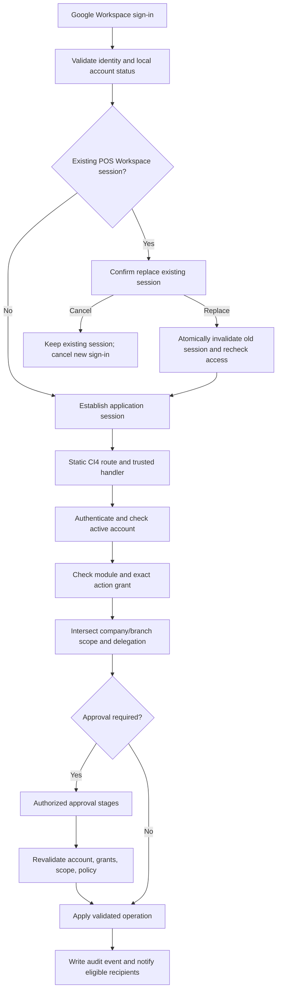

# POS Workspace V3 — Project Blueprint

## Current product objective (owner-provided; requirements may evolve during development)

The product goal is **POS Workspace V3 — POS Support Admin Console and Masterfile & Report System**: a centralized system for POS support administration, masterfile and report workflows, access management, and related operations. Deliver it incrementally, one module at a time; allow requirements and schema to evolve during development, and mark a module finalized only after its database structure, permissions, backend workflows, tests, and the owner's explicit confirmation are complete.

## How to read this document

- **Confirmed project fact** means current source/configuration demonstrates it.
- **Confirmed product requirement** means the project owner explicitly requires it. It does not mean the feature has been implemented.
- **Proposed design** means a candidate approach that still needs review/approval.
- **Unresolved decision** means requirements are not yet specific enough to implement safely.

Keep requirements and implementation evidence separate. `PROGRESS.md` records implementation status. `DATABASE.md` records only verifiable schema evidence.

## Confirmed project facts

- The repository is a CodeIgniter 4 starter application. `composer.json` requires PHP `^8.2` and `codeigniter4/framework` `^4.7`.
- The configured default database driver is MySQLi. The connection's database name is blank in the PHP config; no secret-bearing `.env` values were inspected.
- The active static route table now contains `/`, Login and Google Workspace authorization/callback, CSRF-protected credential/session POSTs, protected `/dashboard`, and protected POST `/logout`. Business-module routes, including `/superadmin/dashboard`, Module Registry, User Management, approvals, Outlet List, organization, and lookup pages, have been removed from the active route table for the requested clean baseline. Auto-routing is disabled. Their source files are retained and are not evidence that these pages are currently reachable.
- The root route sends unauthenticated visitors to Login and all authenticated roles to `/dashboard`. Authenticated visits to `/login` and successful credential or Google sign-in also redirect to `/dashboard`. `AuthFilter` remains on `/dashboard`, so the landing page still validates the active registered session, account status, domain, and application readiness.
- The login page presents Google Workspace as the primary sign-in method and POS Workspace Credentials as a secondary method revealed after selection. It retains the account-setup modal and active-session replacement confirmation. OAuth runtime configuration and authorized browser login remain unverified.
- `Login::google()` builds a Google OAuth authorization redirect using environment configuration and a session-bound state value. The registered callback exchanges the code over TLS-verified HTTPS, validates Google userinfo (`sub`, verified email, and an optional allowlisted hosted-domain claim), and checks the email domain against the configured exact allowlist before account lookup or creation. It then matches an existing account and requires an active account and role plus application access readiness.
- Deployment must provide `google.clientId`, `google.clientSecret`, `google.redirectUri`, and `google.allowedDomains` through private environment configuration; the redirect URI must exactly match the deployed `/login/google/callback` URL. `google.allowedDomains` is a comma-separated list of explicitly approved Workspace domains. Missing, empty, malformed, wildcard, or unapproved values fail closed. Configuration values must not be copied into source control or documentation. Runtime configuration presence and end-to-end Workspace sign-in remain unverified.
- Existing account data is not automatically changed or deleted when the allowlist changes. An account whose email domain is no longer allowed cannot start a Google sign-in and is denied on the next protected request; that request revokes its current POS session. Existing grants and role assignments are preserved for administrator review.
- Successful Google authentication regenerates the session ID. The callback does not persist provider tokens. It saves a validated Google picture URL in `usr_accounts.avatar_url`, fills only blank first/last-name columns from optional Google profile claims, and the authenticated workspace displays the saved picture. Non-empty names are preserved.
- The login view presents Google Workspace first, followed by an OR divider and a secondary POS Workspace Credentials option. Username/password fields remain hidden until selected. Credentials use the existing unique `username` and nullable `password_hash` fields with PHP `password_verify()`; no enrollment/reset flow is provided, and no account data is changed by the sign-in feature.
- `/dashboard` is the only active authenticated page route and is protected by `AuthFilter`. The filter continues to validate session registry, domain, account status, and application readiness. Logout and session-replacement actions remain CSRF-protected POSTs. Superadmin-only and business-module pages are not reachable through the active route table.
- The Superadmin Dashboard controller and view remain in source but are not registered as active routes in the clean baseline. Earlier metrics/approval behavior in that retained code is not part of the current reachable UI.
- The responsive workspace shell retains emerald primary theme tokens, responsive layout behavior, the single Overview navigation link, account menu, and sign-out form. Business-module navigation links have been removed from the active shell; their controllers and views are retained but deactivated by route removal.
- The separate pending-account view and static starter welcome page were removed; the pending-account state is handled by the Login page's existing modal.
- `DATABASE.md` records seven applied migrations as of the read-only 2026-10-25 migration-status check, including the Module Registry extension in batch 3. Earlier table inventories are dated snapshots and do not represent a current full inventory.
- Git is not initialized in the project directory as inspected on 2026-10-22.

## Confirmed product requirements

These are owner-confirmed requirements for the product; implementation is not established unless separately confirmed in code and tracked in `PROGRESS.md`.

### Language and compatibility

- All POS Workspace V3 system UI text must always be in English.
- Use emerald green as the primary action/accent color, white and soft-gray light surfaces, rounded cards, subtle shadows, readable typography, accessible contrast/focus states, and responsive layouts. Dark navy may be used for navigation or appropriate sections. This 2026-10-25 owner direction supersedes the earlier blue-primary proposal below; shared primary theme tokens and the Superadmin Dashboard use emerald.
- Preserve the existing CodeIgniter 4 architecture and current working code.
- Develop incrementally: build a small coherent change, run the relevant checks, and collect feedback before expanding the implementation. Record what was verified and what remains untested; do not represent a planned feature as complete.
- Inspect the repository, current routes, reusable components, authentication, database configuration, tables, and migrations before each module. Summarize current behavior and intended files before broad changes. Reuse working components and conventions; do not rebuild or remove working features unnecessarily.
- For each module, define its purpose, workflow, schema, relationships, permissions, and dependencies before implementation. Follow the cycle **Build → Test → Revise → Retest → Finalize → Proceed**. Do not move to the next major module while the current module is under review; finalize only after explicit owner confirmation.
- Use CI4 migrations or version-controlled SQL for approved schema changes. Preserve existing data, inspect dependencies, and prepare a backup before destructive or high-risk operations unless the owner explicitly directs otherwise. Do not drop tables, reset the database, or delete user data without explicit approval. Avoid schema for unapproved features.

### Responsive Design and Multi-Device Compatibility Standard

This is a permanent product and acceptance standard for the shared workspace and every current or future module. It defines a requirement; it does not certify that existing screens have been tested or satisfy it.

#### Primary design target

- Laptop is the primary design and development target. Optimize common workflows, information density, and navigation for laptop use first, while keeping every supported device size fully usable.
- Preserve the POS Workspace V3 design system: emerald-green accents and primary actions, white and soft-gray surfaces, rounded cards, subtle shadows, clean icons, and consistent navigation. Optional dark navy areas may be used where appropriate.
- All application UI text, including labels, actions, validation, errors, dialogs, and navigation, must remain in English.

#### Supported devices

Every screen and workflow must support mobile phones in portrait and landscape, tablets in portrait and landscape, laptops, desktop PCs and monitors, and large event displays and ultrawide screens.

#### Responsive behavior

- **Navigation:** Use the full sidebar on suitable laptop and desktop layouts. Use collapsible, compact, or otherwise space-appropriate navigation on smaller screens. Navigation must remain reachable and must not obscure page content or controls.
- **Dashboard:** Adapt summary-card count and arrangement, charts, and supporting panels to available viewport space. Keep key information readable and avoid fixed-width layouts or oversized gaps on wide displays.
- **Forms:** Use multi-column layouts where they improve laptop and larger-screen workflows. Stack fields on smaller screens, preserve logical reading and tab order, and keep labels, validation feedback, and actions associated with their fields.
- **Tables:** Preserve important columns and row actions. Place wide tables in a responsive container that can scroll horizontally without causing the whole page to overflow. Where practical, provide a compact card/list alternative for narrow screens; do not silently remove essential data or actions.
- **Search and filters:** Keep related controls aligned on larger screens. Allow controls to wrap or stack on narrow screens while keeping labels, values, and submit/reset actions usable.
- **Modals and dialogs:** Keep dialogs within the viewport, including on short landscape screens. Long content must scroll inside the dialog or use another clear, accessible scrolling treatment; actions must remain reachable and must not be clipped.
- **Content and actions:** Prevent horizontal page overflow, clipped fields, hidden primary actions, and overlap between navigation, content, and overlays. Let content use wide screens without stretching reading lines or controls beyond comfortable use.
- **Orientation and resizing:** Layouts must remain usable when device orientation changes, the viewport is resized, or browser zoom is increased. Do not make essential workflows depend on hover or a fixed viewport height.

#### Acceptance and verification

- Review representative workflows at mobile portrait/landscape, tablet portrait/landscape, laptop, desktop, and ultrawide/event-display sizes. Check navigation, cards/charts, form entry and validation, table access, search/filter wrapping, and dialog scrolling.
- Confirm all essential controls remain visible or reachable by scrolling, keyboard focus remains visible, and touch targets work on touch devices.
- Record responsive browser/device checks separately from automated tests. A responsive CSS rule or documented requirement alone is not evidence that a screen has passed device verification.

### Security and delivery

- Enforce authentication, account readiness, module/action permissions, and data scope server-side on every relevant request. Validate all input and prevent SQL injection, XSS, CSRF, and cross-user record access. Use transactions for related writes.
- Where separation of duties is required, prevent requesters from approving their own requests. Preserve historical attribution when transferring task or file ownership.
- For each module, record implemented behavior, files changed, database changes, manual test instructions, automated test results, and known limitations. Test normal and invalid input, authorization boundaries, approvals, migration safety, regression, and keyboard/touch accessibility where applicable. Never claim an unrun test passed.

### Login and activation

- Google Workspace is the primary sign-in method and must be displayed prominently at the top of the login card. POS Workspace Credentials is a secondary sign-in method revealed only after selection. Credential login must use securely hashed local credentials; Google passwords must never be requested or stored.
- Google authentication must enforce server-side account activation and authorization. Superadmin GOD MODE requires an active account with Superadmin explicitly assigned.
- New Google users are automatically registered as `PENDING`, with no role, employee code, or module access, until administrator setup is complete. Google email remains verified and unique; do not invent placeholder names or assign roles automatically.
- When Google supplies them, save first and last name from the verified profile claims. Save the Google profile picture in `usr_accounts.avatar_url` and show it in the authenticated workspace. Birthday is an optional user-entered profile detail in Account Summary and must not be requested from Google sign-in.
- Pending users see the Account Setup Pending modal on the existing login screen.
- New users require administrator activation and assigned module access before normal use.
- Google sign-in accepts only a Google userinfo identity with a non-empty subject and verified email whose normalized domain exactly matches `google.allowedDomains`. If Google supplies `hd`, that hosted domain must independently match the allowlist; Workspace email aliases may use a different approved domain. The check occurs before account lookup or creation. Protected requests recheck the stored email domain; a now-disallowed account is denied and its POS session is revoked. Existing account rows and grants are preserved for administrator review.

#### Single Active Session per Account (implemented; live migration verified 2026-10-25)

- A POS Workspace account may have at most one active application session. This does not sign the user out of Google Workspace or revoke an identity-provider session.
- If a second sign-in finds an active application session, show title **Account Already Signed In**, message **This account is already signed in on another device. Do you want to sign out the existing session and continue?**, and buttons **Cancel** and **Sign Out & Continue**.
- Cancel leaves the existing POS Workspace session valid and cancels the new sign-in. Sign Out & Continue must revalidate account status, role, permissions, scope, and other security checks, then invalidate the previous application session before establishing the new one.
- Enforce replacement on the server with secure unpredictable session identifiers/tokens and a concurrency-safe per-account operation. Handle expired sessions, disconnected devices, and concurrent requests. Never expose session identifiers in URLs or logs.
- Record successful and failed login, logout, and replacement events without recording credentials or tokens. Explain expiration and connectivity behavior in user-facing English.
- `app/Database/Migrations/2026-10-25-000006_CreateActiveSessions.php` creates an InnoDB `sec_active_sessions` registry with one row per account, a SHA-256 hash of the POS session ID, and idle expiry/activity timestamps. The live MariaDB 10.1.19 database reports this migration applied; live `SHOW CREATE TABLE` verified the primary key, expiry index, account foreign key, and InnoDB engine. The table was empty immediately after migration.
- `ActiveSessionService` serializes login claims/replacements by locking the account row in an InnoDB transaction, rechecks application readiness, updates the unique account row, and writes the audit event in the same transaction. An active session conflict is confirmed in the login UI; Cancel records cancellation only, while replacement swaps the registry hash. `AuthFilter` checks the hash, idle expiry, account/role state, and access on each protected request. Logout revokes only the current POS session hash and does not call Google logout.
- CI4 continues to use `FileHandler` with a 7,200-second expiry. Automatic periodic ID rotation is disabled because the registry tracks the current ID hash; successful authentication/replacement explicitly regenerates and verifies a changed session ID before the registry row is committed. Protected requests extend the registry idle expiry. Existing in-flight requests that passed the filter before a replacement can finish; each protected request beginning after replacement rejects the old hash.
- In the `production` CI environment, `App` forces HTTPS and the session cookie receives the Secure attribute; local development/testing retains its environment-specific transport behavior. Deployment must set `CI_ENVIRONMENT=production` behind a correctly configured HTTPS endpoint.
- Security events are written through `AuditLogService`. Audit payload keys that could contain credentials, tokens, cookies, or session identifiers are redacted. Google OAuth runtime configuration and an end-to-end provider login remain deployment checks; no OAuth secrets are stored by the application.

The login and registration requirements above are owner-confirmed. Keep implementation status separate from requirements: live account and role definitions, including the nullable legacy `password_hash`, remain preserved. Full schema facts are recorded in `DATABASE.md`.

### Roles and permissions

- Support Superadmin, regular users, and viewers.
- Normal users receive only assigned active modules and permitted actions: module/action availability, the role grant, and the individual user grant must all allow the action. Viewers are read-only and may use only `VIEW` actions.
- Supervisors may manage only their directly handled employees and only for modules, companies, and branches within their own authorization and scope. Position alone grants no access.
- Users may edit non-privileged profile fields. Module access, company/branch scope, role assignment, and reporting-line changes require applicable approval; unapproved changes do not become effective.
- Positions and departments are configurable lookup records managed by Superadmin.
- Assign permissions by module.
- Support company and branch access scope per user and per module.
- Validate account status and authentication, explicitly assigned role, module access, allowed actions, company/branch/outlet/device/personnel/record scope, and applicable approval requirements as distinct authorization checks. Hiding UI controls is not sufficient; enforce access on the server.
- Module-wide action availability must be intersected with each user's individual module/action grants. Superadmin configuration must not grant regular users access, and unsupported actions must remain unavailable rather than being enabled by registry metadata.
- Show Read as the `VIEW` permission code. Required Approval cannot weaken a mandatory global approval rule; when approval is required, the action must fail closed unless a valid workflow and active eligible approver exist.
- Organizational position alone does not grant module access. A Supervisor must not delegate permissions or data scope beyond their own authorized boundaries.
- Supervisors may configure only explicitly delegated local permissions for employees within their handled-user scope, and only for modules, actions, companies, branches, departments, and other scopes they are themselves authorized to manage. Local RBAC cannot exceed global permissions or weaken global policies. Pending permission changes do not become effective before required approval; existing effective access remains unchanged unless an authorized security action revokes it.

#### Module Action Registry and action-specific authorization (confirmed requirement)

- Each module defines stable action keys, display names, descriptions/categories, enabled state, and a mapping to a trusted implemented server-side handler or authorization policy. Examples include `inventory.transfer.request`, `inventory.transfer.approve`, `reports.send`, and `reports.schedule`; requesting and approving are separate permissions.
- A catalog entry is not executable functionality. Only developer-maintained routes and reviewed handlers can be mapped; registry metadata must never accept arbitrary PHP, SQL, scripts, or controller routes.
- Permission to request an operation never implies permission to approve it. Check active authentication/account, module assignment, exact action grant, company/branch scope, hierarchy/delegation where applicable, approval policy, and business validation on every protected operation.
- Keep module-wide action availability separate from per-role and per-user action grants. Disabled or unsupported actions fail closed, even when a UI control is visible.

### Global and local module policies

- Superadmin controls global module definitions and mandatory system rules, including module registration and identity, available actions and permitted workflows, mandatory approval requirements, whether a Module Administrator is required or permitted, which local policy settings are configurable, data-scope rules and delegation boundaries, and mandatory audit and recovery requirements.
- CRUD actions are not required for every module; some modules, such as dashboards and activity logs, may be view-only.
- Superadmin must be able to set Local Policies ON or OFF for each module and control which local policy categories are available. Turning Local Policies ON does not enable every category automatically.
- When Local Policies are ON, only authorized local administrators may configure globally permitted settings, with the required module permission and within their company, branch, outlet, device, personnel, and other applicable scope. Examples include local approval requirements, permitted data-scope assignments, report recipients and schedules, and handled-user configuration.
- Regular users may not modify Local Policies unless explicitly authorized. Viewers remain view-only.
- When Local Policies are OFF, local configuration is disabled and existing local settings remain effective but read-only under the approved design. Do not silently reset, delete, or replace those settings. Any transition or later change must preserve existing workflow behavior unless separately approved.

### Parent modules, submodules, and navigation

- Support parent modules and nested submodules. Each submodule must reference its parent module.
- Superadmin must be able to configure module names, short names/codes, parent relationships, icons, display order, active status, and permitted local policy categories through the database-driven Module Registry and Module Settings.
- Developers maintain actual route definitions and controller mappings in CodeIgniter 4's `app/Config/Routes.php`. Database records may not create executable routes or dynamically change controller mappings.
- Validate parent relationships and prevent circular module hierarchies.
- Generate the sidebar from active module records and their parent/submodule relationships stored in the database. Use the configured module name, short name/label, icon, and display order.
- Display only modules and submodules authorized for the logged-in user. Inactive modules must not appear in normal navigation.
- Derive parent visibility from accessible descendants: show a parent when the user has access to at least one active, accessible child; hide it when no such child exists. In nested hierarchies, propagate visibility upward when any accessible descendant exists.
- Parent visibility is for navigation only. It does not grant access to the parent route, sibling submodules, or actions, and it does not automatically grant child permissions.
- Independently enforce each submodule's route access, action permissions, account status, and data scope on the backend.
- Enforce route access, action permissions, account status, and data scope on the backend independently of sidebar visibility.
- Enforce module access and permissions on the backend for every protected route and action. Hiding a sidebar item is not authorization.
- Superadmin controls global module configuration, subject to authentication and audit safeguards.
- Module names listed as examples or candidates elsewhere in this blueprint are not thereby confirmed as the final module catalog.

### Dynamic Superadmin Module Registry

**Status: Additional owner-confirmed product requirement (2026-10-23).** The requirements below describe the intended registry and lifecycle behavior; existing implementation and gaps are recorded separately in `PROGRESS.md`.

- Superadmin must be able to view and search the complete registered module catalog, independent of which modules are assigned to regular users. The registry must support category, lifecycle status, and availability filters.
- Superadmin must be able to add modules, configure and edit their metadata, and activate, deactivate, or restore modules where appropriate. The registry must support configuration of navigation, permissions, user eligibility, company/branch scope, approval workflow, hierarchy, reports, and notifications.
- The Permissions / Module Access screen must expose module-wide action availability and Required Approval controls separately from per-user grants. Only actions backed by trusted, implemented handlers and developer-maintained routes may be configurable. Preserve Superadmin access and mandatory global approval rules; audit sensitive changes.
- Add Module uses a details step followed by optional selection from the existing shared action catalog. Selected actions are assigned to that module through existing permission records in the same creation workflow; this does not create action definitions, routes, or executable features. Category containers have no actions. Do not add schema for this workflow.
- Use a database-backed registry and shared navigation/configuration services so registered modules do not require duplicated sidebar/navigation implementations. Use data-driven registration/configuration where supported by the existing architecture.
- Registry metadata is descriptive configuration only. It must never execute arbitrary PHP, SQL, scripts, or dynamically supplied routes. A module may expose functional screens/actions only through trusted, implemented backend components and explicitly maintained CodeIgniter 4 routes.
- Show implementation status. If executable functionality is absent, do not imply that it exists and prevent misleading activation or success messages.
- Support `DRAFT`, `ACTIVE`, and `INACTIVE` lifecycle states. Validate module codes and reject duplicates.
- Before deletion, check dependencies and require appropriate authorization and explicit confirmation. Prefer deactivation when historical records, assignments, approvals, or audit references exist. Never implicitly delete business data, user assignments, approvals, or audit history because a module is deactivated or removed from navigation.
- Record sensitive registry and lifecycle actions in the audit log. Preserve mandatory approval rules and existing authentication, authorization, and other security controls.
- The meaning and data source of an “availability” filter, and the exact eligibility rules/dependency policy for permanent deletion, remain to be specified before implementation.

### Module Settings and responsive interface requirements

- The Module Settings dashboard must present the module registry with search and useful status/type/category filters, module description and status, company/branch filtering and approval indicators where configured, and actions to configure an entry or start a new draft. Provide an appropriate table layout on wider screens and readable cards or equivalent layouts on narrow screens.
- Present Module Registry and module-specific management as one Superadmin Module Settings destination with a module selector and section navigation. The registry catalog and module configuration should share the workspace; do not expose separate Module Registry and Module Management navigation entries.
- The module Profile screen should use a responsive, card-based layout with editable module information, a preview, static-implementation/route information, module policy summaries, and approval/approver summaries. Clearly distinguish saved read-only state from editable configuration; do not imply an icon upload, API endpoint, permission/policy write, or approver assignment exists unless supported by the application.
- Superadmin may import module icon images using click-to-select or drag-and-drop. Accept PNG, JPEG, and WebP only; enforce a 2 MB upload limit, verify and re-encode image content before storage, and use server-generated filenames. This requirement does not authorize schema changes or executable upload content.
- Keep per-module row actions in the three-dot menu, including module configuration, a quick lifecycle-status control, and eligible deletion. Status changes must continue through the existing authorized, CSRF-protected lifecycle action and retain its implementation checks and audit behavior.
- Provide a reusable workspace-wide loading indicator for same-origin page navigation and server-submitted forms that may wait on database work. Do not show it for cancelled submissions, same-page anchors, external/new-tab links, or downloads. Expose a shared show/hide API for asynchronous actions, and ensure those actions hide the indicator on both success and error.
- Module configuration is organized into Profile, Permissions/Module Access, Company/Branch Scope, Approval Workflow, Hierarchy, Reports, Notifications, and Activity/Audit sections. These sections must reflect the underlying saved state accurately; a display control must not imply a grant or configuration was saved when no supported write operation exists.
- Global Policies and Local Policies are separate Superadmin navigation destinations. Global policy authority and local policy settings remain distinct; local settings may expose only globally permitted categories and cannot weaken mandatory global rules.
- Creating a module begins in `DRAFT`. Activation must not expose a route unless the destination is backed by a developer-maintained static route and implemented handler. Route, controller, and component metadata remain descriptive and must not be interpreted as executable routing instructions.
- All system interfaces must adapt to mobile phones, tablets, laptops, standard desktop monitors, large monitors, event/presentation displays, and ultrawide screens. Use a consistent responsive layout; the sidebar may become a navigation drawer on smaller screens. Forms, buttons, search and filter controls, cards, tables, and modals must adapt to available space. Avoid overlapping, clipped, or inaccessible controls. Wide tables may scroll horizontally within their own container. Modals must fit the viewport and may use internal scrolling. Preserve readable typography, sensible spacing, keyboard navigation, visible focus indicators, and touch-friendly controls. Use available large-screen space effectively; do not simply shrink every element. Login, dashboards, Module Settings, User Management, Approval Queue, and reports follow the same standard.
- The initial appearance is Light Theme. Prepare reusable components and centralized CSS tokens for both Light and Dark themes, including backgrounds, text, borders, shadows, navigation, controls, focus, and status colors. Keep styling independent of theme selection and maintain readable contrast in both themes. Do not build a complex theme manager or add theme persistence until separately required. Use the current emerald-primary, white/soft-gray design direction with navy navigation where appropriate. All interface text remains in English.
- A future Theme Settings feature may offer Light Theme, Dark Theme, System Default, accent colors, and other approved appearance preferences. These are planned options, not current requirements to implement. When user-level preferences are added, store them independently per user; invalid or missing preferences must fall back to Light Theme. User preferences must not change another user's appearance, global branding, or protected administrative settings without authorization, and must not affect permissions, scopes, approvals, or business rules. Prefer a reusable theme service or centralized configuration. Do not add theme persistence schema merely to establish the initial Light Theme tokens.
- Test representative phone, tablet, laptop, desktop, and ultrawide viewport sizes. Record viewports and any cases that cannot be tested automatically; do not claim browser verification unless it was performed.
- These responsive and Module Settings requirements do not make the business module catalog final or approve any database policy, permission grant, scope assignment, approval rule, or approver assignment.

### Database table naming convention

- Use lowercase `snake_case` for all table and column names. Every table must have a meaningful prefix identifying its functional group; related tables must share that prefix. Follow the existing singular/plural convention consistently, and do not choose a prefix based only on record type when another module owns the table.
- Initial prefix registry: `usr_` for user identities, accounts, profiles, and account status; `rbac_` for roles, permissions, role assignments, and access policies; `mod_` for module registry, settings, and configuration; `org_` for departments, positions, reporting hierarchy, and organizational relationships; `out_` for Outlet List data; `tsk_` for task assignment/status/work tracking; `dpl_` for deployments/checklists; `doc_` for documents, file versions, and documentation metadata; `apr_` for approval requests/stages/decisions; `log_` for audit logs/activity history; `sec_` for authentication/session security; and `ntf_` for notifications/email queue records. This registry may be extended when a new module is approved.
- Each table must have one documented owning module or shared platform component. Shared authentication, authorization, organization, approval, and audit structures must not be duplicated inside individual business modules. For example, Outlet List must reuse shared `usr_`, `rbac_`, `mod_`, `apr_`, and `log_` components where applicable.
- Check the live schema and dependencies before proposing table creation. Identify duplicates and naming conflicts, and propose renames separately from new tables. Any rename or prefix change requires a controlled, separately approved migration that updates dependent models, queries, foreign keys, tests, and documentation. Never rename or drop an existing table solely for naming consistency.
- Prefix examples and registry entries do not prove a table exists or authorize table creation or renaming. Preserve current table names until schema reconciliation and any required migration have been reviewed and approved. Document each verified or proposed table's purpose, prefix, relationships, and owner in `DATABASE.md`.

### Confirmed Superadmin GOD MODE requirement

**Status: Owner-confirmed product requirement (2026-10-22).** This describes required behavior; implementation is not established by this documentation.

- Superadmin has system-wide administrative access to all registered current and future modules.
- Superadmin can access all companies, all branches, and every available company/branch filter without individual company/branch scope assignments.
- Superadmin can access all module data and reports within the application's defined business rules and available data.
- When exercising authorized Superadmin privileges, Superadmin is exempt from ordinary user module assignments, company/branch restrictions, reporting hierarchy restrictions, and ordinary Module Admin approval workflows.
- Superadmin can manage users, roles, module access, module registry, approval settings, hierarchy, and system settings.
- Superadmin access does not bypass authentication, secure session handling, input validation, or other essential security controls.
- Sensitive Superadmin actions must be recorded in the activity/audit log.
- Regular users, viewers, supervisors, and Module Admins retain their own assigned permissions and scopes. Superadmin GOD MODE does not grant those users additional access.

### Company Management initial scope

**Status: Owner-confirmed product requirements (2026-10-23).** These requirements do not imply that the approval workflow or every Company Management operation is implemented.

- Use the existing active `COMPANY_BRANCH` module for Company Management. Do not create a duplicate module.
- Superadmin may access Company Management while the account and assigned Superadmin role are active. Other users require explicit per-user module access and the relevant action permission.
- For non-Superadmin users, company access is the intersection of the module-level company allowlist and the user's active company scope. Apply applicable branch scope and company/branch relationship checks independently on the backend.
- Company codes are trimmed for leading and trailing whitespace before validation and storage, and must remain unique.
- New companies start as `INACTIVE`. Do not hard-delete companies in the initial implementation.
- Company creation, edits, and status changes require approval. Company status changes use the `UPDATE` permission. Superadmin must not bypass approval required by a mandatory global policy.
- Approval-required company actions must remain unapplied until all required approvals are complete. If no valid approver is assigned, block the action and display exactly: “This action cannot proceed because no approver is assigned. Please contact your administrator.” Do not automatically approve or apply the change.
- Authorized Company Management users may view inactive company records for administration. Normal operational use of an inactive company and its dependent branches/resources must be blocked server-side.
- Deactivating a company preserves its company and branch records and does not rewrite branch statuses. A branch is operationally eligible only when both its own status and its parent company's status permit operation.
- Branch CRUD is outside the initial Company Management scope.

### Approvals and reporting relationships

- Support module-specific approval workflows and an Approval Queue.
- Support reporting hierarchy and user assignment relationships, including “reported-to” and “handled employees.”
- A Module Administrator assigned to a module does not need separate approval for their own authorized CRUD actions within that module. Other users follow the configured approval policy.
- If no Module Administrator is assigned, approval behavior follows the authorized Supervisor or configured hierarchy policy, subject to mandatory global rules.
- Local settings cannot disable a mandatory global approval requirement. If approval is required but no valid approval route exists, block the protected action until configuration is corrected.
- If an action requires approval, a valid approver must have an active account and explicit authorization for the relevant module, action, and applicable data scope. If no such approver is assigned, block the protected action. Do not bypass approval because an approver is inactive, unauthorized, unavailable, or outside the applicable scope.
- Never automatically approve, execute, or apply a protected change because an approver is unavailable or no valid approver is assigned. Do not introduce automatic approval exceptions or fallback approvers without a separate explicit decision.
- Apply this policy to create, update, delete, and any other action configured to require approval. When blocked because no valid approver is assigned, display exactly: “This action cannot proceed because no approver is assigned. Please contact your administrator.”
- Where configured, a Supervisor or hierarchy approver acts first, followed by the Module Administrator for final approval. Prevent self-approval when independent approval is required.
- Higher organizational position alone does not bypass a mandatory module approval rule. An authorized Superadmin may override local policies; record each override in the audit log.
- Notify authorized recipients about pending approval requests and decisions. Email addresses do not prove approval authority; validate approver eligibility on the server. Record decisions, decision timestamps, and rejection reasons. Local settings cannot bypass mandatory global approval requirements.

### Work tracking, activity, and employee handover

- The system is intended to support POS team task assignments and status changes, masterfile/documentation updates, deployment tracking, access requests, approvals/rejections, file uploads and revisions, ownership transfers, and employee handover.
- Record meaningful application activity with actor, action, affected record, timestamp, and relevant change details. Preserve historical attribution when ownership changes. Ordinary users must not alter or delete protected audit records.
- Activity records describe work performed in the application. Do not claim to monitor activity outside the application or make unsupported productivity-surveillance claims unless an approved integration actually implements that capability.
- Configure eligible approvers and notification recipients only for authorized administrators and within applicable global/local policy and data-scope limits.

### Superadmin safeguards and audit log

- Superadmin authority requires an active account with the Superadmin role explicitly assigned. Never infer it from email address, email domain, or login method.
- Superadmin authority does not bypass authentication or account-security checks. Sensitive overrides must record a reason where designated, and audit history must not be silently altered or bypassed.
- Record relevant successful, failed, and denied sensitive actions, including global module configuration and local policy changes; Superadmin overrides; account, role, permission, and data-scope changes; approval decisions and workflow changes; record creation, update, archive, restore, import, and revert operations; report configuration and scheduled email outcomes; and audit-log access and permitted exports.
- Audit details should include actor account and role, action and affected module or record, timestamp, previous and new values when applicable, relevant data scope, result, reason for designated sensitive actions, and related request or transaction reference when available.
- Never store passwords, authentication tokens, or other secrets in audit details. Normal administrative users must not silently modify or erase audit history.

### Module workflow governance

- Superadmin controls global workflow definitions. Selected users may create or configure processes only when explicitly granted delegated authority and within configured limits.
- Candidate modules for documentation and discussion include Outlet Management, Inventory Management, BIR Management, POS Management, User Access Management, Module Registry, Approval Queue, Reports and Scheduled Email, Organization and Hierarchy, and Audit and Recovery. This candidate list is not a final approved module catalog.

## Planned Superadmin areas

The requested Superadmin areas are product requirements. Individual screens may be implemented; implementation status is tracked in `PROGRESS.md` and must not be inferred from this list:

- Dashboard
- Profile
- Module Access
- Company/Branch Scope
- Hierarchy
- Activity Log
- Approval Queue
- Module Settings
- System Settings
- Reports
- Module Registry / Create New Module

## Planned modules and workflows

The first-implementation scope below was recorded on 2026-10-23 and is historical planning context. The later screen/controller removal means it is not a statement of current implementation. Reconcile the next implementation scope with the current roadmap and owner priorities before coding.

The exact business module catalog is not yet specified. The owner-confirmed requirements include module access, module-specific approvals, and module settings/registry. Earlier candidate areas for discussion include point-of-sale transactions, products/catalog, inventory, purchasing, customers, and reporting; these candidates are **proposed**, not an approved delivery scope.

**Current requested first implementation scope (2026-10-23; schema reconciliation and review are prerequisites):**

- Complete a database-backed Module Settings workflow with Profile, Module Access, Company/Branch Scope, Approval, Hierarchy, Reports, Notifications, and Activity Log sections. Load and save actual supported configuration; do not present static controls as persisted settings.
- Add Account Management for account search/filter/pagination, profile, role and module access, permissions, company/branch scope, position/department, primary `Reports To`, handled employees, activation/deactivation, effective-access preview, and relevant access history. A supervisor may see or configure only users and settings within delegated authority. Never display password hashes or secrets.
- Build **Outlet List** as the first functional test module. Reuse a verified existing outlet master table if present; otherwise propose a module-owned `out_` table after dependency review and approval. Support outlet code/name, company, branch/location where applicable, active/inactive status, search/filter/detail, and create/edit only where authorized. Do not register it as functional until its static route, handler, permissions, and saved configuration exist.
- Use the completed Outlet List flow to verify Superadmin, Supervisor, and Regular User boundaries, pending/approved/rejected changes, direct URL and request-parameter enforcement, audit history, regression, responsive viewports, theme-token readiness, and English-only system messages. Record actual tests and limitations.

These requirements do not authorize schema changes before the current schema reconciliation and naming conflicts are reviewed. Do not duplicate shared account, RBAC, approval, organization, or audit structures inside Outlet List.

At a high level, the requested user lifecycle is: Google Workspace sign-in → administrator activation and assignment of role, modules, company/branch scope, and reporting relationships → normal use only after required activation and access assignment. This describes a requirement, not the current implementation.

## Proposed designs

No complete business-module schema, module-specific permission matrix, or module plug-in architecture has been approved in the inspected documentation. The owner has confirmed the core approval rules (configured stages run sequentially, every required stage approves, rejection is terminal, and pending values do not take effect); corresponding source support exists for Outlet List and `USER_ACCESS` changes but does not complete every approval-dependent workflow. Avoid turning candidate modules into a committed catalog. Present other designs for review before implementation, especially when they affect authentication, authorization, routes, or database schema.

## Master architecture and system flows (requirements and proposed design)

The diagram describes the intended guarded request path. Current source includes Login and protected dashboards, Module Registry, organization maintenance, User Management and its approval queue, and Outlet List, with auth, grants/scope, approval, and audit behavior in filters/services. The remaining business modules and notification delivery are not implemented. The diagram is a system-wide target, not evidence that every listed check is integrated into every route.



**Intended authorization order:** authenticate and verify active account; resolve the static route/action; verify module assignment and exact action permission; intersect module and user company/branch scope; apply hierarchy/delegation constraints; enforce approval policy; validate business data; apply atomically; record audit details and notify. Approval and mutation must be server-side. A failed check denies the operation regardless of visible UI controls.

## Module Registry and action lifecycle (confirmed requirements)

- Registry metadata includes stable module key, name, menu label/description, audience/workspace, developer-owned route/handler reference, status, registered actions, assigned module administrators, applicable approval policy, and display order/navigation configuration.
- Action metadata includes stable unique key, display name, category/description, enabled state, and a reviewed mapping to an implemented handler/policy. Example action keys are namespaced by module and verb, such as `inventory.transfer.request` and `inventory.transfer.approve`.
- A registered or enabled module is operational only after route, handler, permission, and required configuration validation. Metadata does not create routes or implement features. Unsupported actions stay disabled.
- Approval modes are **No Approval**, **Hierarchy Approval**, **Global Module Administrator Approval**, and **Combined Approval**; policies may be module/action-specific. Local policies cannot weaken a mandatory global policy.

### Phase 3 implementation boundary (2026-10-25)

- A Superadmin-only registry interface is implemented at `/superadmin/modules`; create, edit, configuration, and status changes use explicit routes and server-side filters. The registry supports search, type/status filters, pagination, module metadata, audience assignments, active module-administrator assignments, action metadata, and a Superadmin navigation preview.
- Migration `2026-10-25-000007_ExtendModuleRegistry` adds audience and module-administrator mappings, action display/handler metadata, and the `COMBINED` approval mode. Read-only verification on 2026-10-25 reports it applied in batch 3; its created tables and added action columns were present. No further migration is needed for this extension.
- Trusted handler keys are allowlisted in `ModuleRegistryService` for Module Registry, Employee Management, and Outlet List. Registry metadata does not create handlers or user permission grants. Module administrator metadata does not itself grant permissions; `COMBINED` approval consults those assignments and independently requires active `APPROVE` authorization and applicable scope. `ADMIN` continues to use ordered `apr_module_approvers`.
- The Module Registry configuration form now edits module-level company and branch allowlists using the existing `mod_module_companies`, `mod_module_branches`, and organization lookup tables. Branches must belong to a selected company; newly configured scopes require active organization records. Removing a module mapping does not delete per-user assignments, and effective access still requires the module/user scope intersection.
- Superadmin organization maintenance is available at `/superadmin/organization` for creating, editing, and retiring companies and branches. Records are preserved rather than deleted; branches cannot be moved between companies and cannot be activated while their company is inactive. This is source/test evidence, not a live organization-data deployment check.

## Phase 4 — User Management and Access (owner-confirmed design; implementation in progress)

### Confirmed policy and scope

- Provide account search/filter/pagination, detail/profile, lifecycle administration, role assignment, module/action access, company/branch scope, direct handled-employee management, reporting lines, effective-access preview, and account/access history.
- Normal-user access requires an active account and role, active module and enabled action, and both role-level and individual-user grants. Viewers may use `VIEW` only. Superadmin remains an explicit active-role exception and still passes authentication, Workspace-domain, and session checks.
- Supervisors may manage only direct reports in `org_reporting_lines` and only within their own authorized modules and company/branch scope. Handled employees are the same relationship as direct reports. They cannot delegate permissions or scope they do not have. Position alone grants no access.
- Users may edit non-privileged profile fields. Module access, company/branch scope, role assignment, and reporting-line changes require applicable approval. Pending changes do not affect effective access.
- Superadmin has full administration authority. Positions and departments are Superadmin-managed lookup records; retire them by setting them inactive and preserve account references.
- `COMBINED` approval runs hierarchy approvers first, then module administrators, removing duplicate approvers. Every required stage must approve; any rejection terminates the request.
- Deactivation or access revocation invalidates the account's registered active POS session. The next protected request must reject the session.
- Account history is visible to the account owner, an authorized direct supervisor within scope, and Superadmin.
- Comprehensive live browser testing is deferred until all project phases are implemented. Automated isolated unit/feature tests are required during implementation.

### Routes and component responsibilities

- `UserManagement` handles account list/detail, self-profile edits, Superadmin lifecycle and organization assignments, approval-backed role/access/reporting-line submissions, effective-access preview, and account history. `UserAccessApproval` handles assigned request listing and decisions. `SuperadminUserLookups` handles position/department maintenance.
- `UserManagementService` implements account search/detail, direct-report and scope checks, self-profile/lifecycle operations, sensitive options, effective-access preview, and account history. `OutletAccessService` enforces action and data scopes, validates/submits typed changes, calculates approval stages, revalidates decisions, and applies approved changes with audit. `UserLookupService` handles Superadmin lookup records. `UserAccountModel` supplies account readiness and effective application-access checks. Authorization remains enforced in services and route filters; view visibility is not authorization.
- Implemented GET routes: `/user-management/users` and `/user-management/users/{id}`. The detail embeds the read-only effective-access preview and account history; indexed account history is unavailable until migration 000008 is applied.
- Implemented POST routes: `/user-management/users/{id}/profile` (self-edit of first name, last name, birthday), `/status` (Superadmin only), `/organization` (Superadmin only; disabled until migration 000008 exists in the database), `/role`, `/module-access`, and `/reporting-line` (approval-backed changes for non-Superadmins).
- Implemented assigned approval queue at `/user-management/requests`, with sequential approval, terminal rejection, and stale-request rejection-only handling. At most one pending USER_ACCESS request is allowed per target account. Account deactivation/suspension removes the registered session and activation requires an active role plus at least one usable module action (except the Superadmin application-access exception).
- Planned future GET routes: `/user-management/users/{id}/access-preview`, `/user-management/users/{id}/history`, and `/user-management/requests` (the first two currently appear on account detail rather than separate endpoints).
- Superadmin lookup routes are implemented: `GET /superadmin/user-management/lookups` and explicit CSRF-protected POST routes to create, update, or change the status of positions and departments. The controller reports lookup storage unavailable while migration 000008 is pending. Retire referenced lookup records instead of deleting them.
- Every route requires authentication and a server-side policy. All state-changing requests require CSRF. Account listing/detail must not reveal inaccessible accounts through IDs, filters, or distinct response behavior.
- Screen responsibilities: searchable account list; account detail and self-edit profile; read-only effective-access preview with denied reasons; subject/scope-limited history; scoped role, action, company/branch and reporting-line editors; assigned User Access approval queue; and Superadmin lookup management. These screens and handlers are present. Account history and lookup assignments require migration 000008 in the configured database; that migration has not been run.
- Excluded from this phase unless separately approved: role-catalog CRUD, credential enrollment/reset, Google OAuth changes, business-module screens, and comprehensive live browser testing before all phases are complete.

### Approved implementation checklist and evidence map

This checklist maps the confirmed Phase 4 requirements to current source, schema, and isolated automated coverage. A source/test checkmark means the behavior is represented in code/tests only; it does not mean the configured database deployment or an end-to-end browser workflow has been verified. The route column records the intended integration points; all business-module routes and navigation are currently deactivated for the clean Login + Landing Page baseline.

| Approved requirement | Controller / service / model | View / route | Migration / schema dependency | Automated coverage | Current status |
| --- | --- | --- | --- | --- | --- |
| Search, filter, paginate accounts; safe account detail; users edit only non-privileged profile fields | `UserManagement`; `UserManagementService`; `UserAccountModel` | `user_management/index.php`, `detail.php`; `GET /user-management/users[/{id}]`, `POST .../{id}/profile` | Existing `usr_accounts`, `usr_roles`, and reporting/RBAC schema; no new migration | `UserManagementServiceTest`; `RouteAuthorizationTest` | Implemented in source and isolated tests; authenticated live flow not verified |
| Superadmin lifecycle; prevent self/last-Superadmin deactivation; revoke registered session on deactivation | `UserManagement`; `UserManagementService`; `UserAccountModel` | `detail.php`; `POST .../{id}/status` (auth + Superadmin + CSRF) | Existing accounts and `sec_active_sessions` (migration 000006) | `UserManagementServiceTest`; `AuthenticatedSuperadminRouteTest` | Implemented in source and isolated tests; configured-database workflow not verified |
| Role, module/action, company/branch access, and reporting-line changes are pending until approval; reject leaves effective values unchanged; preserve Supervisor delegation ceiling | `UserManagement`, `UserAccessApproval`; `UserManagementService`, `OutletAccessService`; `UserAccountModel` | `detail.php`, `approvals.php`; `POST .../{id}/role`, `/module-access`, `/reporting-line`, `/requests/{id}/decision` | Existing role, RBAC, organization, and approval tables (migrations 000001–000007); no new schema identified | `OutletAccessServiceTest`; `UserManagementServiceTest`; `RouteAuthorizationTest` | Implemented in source and isolated tests; MariaDB/live approval flows not verified |
| Superadmin full authority; Supervisors limited to direct reports and authorized module/company/branch scope; Normal users get assigned actions; Viewers are read-only | `OutletAccessService`, `UserManagementService`, `OutletListService`; `UserAccountModel` | User Management and Outlet List views; authenticated routes in `Routes.php` | Existing `org_reporting_lines`, RBAC grants/scopes and module allowlists | `OutletAccessServiceTest`; `UserManagementServiceTest`; `RouteAuthorizationTest` | Server-side enforcement represented and tested; live routed/browser verification outstanding |
| Reporting lines reuse direct-report relation, prohibit self/cycles, and are approval-backed | `UserManagement`, `UserManagementService`, `OutletAccessService` | `detail.php`, `approvals.php`; reporting-line and decision POST routes | Existing `org_reporting_lines` and `apr_*` tables; no separate handled-user table/migration | `OutletAccessServiceTest` cycle and delayed-apply cases | Implemented in source and isolated tests; live concurrency/workflow not verified |
| `ADMIN`, `HIERARCHY`, and `COMBINED` approval routing; deduplicate; every generated sequential stage approves; rejection terminates; prevent self-approval and revalidate approvers/scope | `UserAccessApproval`; `OutletAccessService` | `approvals.php`; assigned request and decision routes | Existing approval/action/admin tables, including 000007 `mod_module_administrators` and `COMBINED` enum | `OutletAccessServiceTest` sequential, rejection, hierarchy, combined, invalid/self approver, stale request cases | Implemented in source and isolated tests; live MariaDB behavior not verified |
| Subject-scoped account history with sensitive-field filtering | `UserManagement`; `UserManagementService`; `AuditLogService` | `detail.php`; included on `GET /user-management/users/{id}` | Requires migration 000008 `log_audit_logs.target_user_id` and its index/FK | `UserManagementServiceTest` history authorization/redaction case | Source/test present; unavailable until migration 000008 is deployed; not live verified |
| Superadmin-managed positions/departments; retire inactive without deleting references; assign lookup to accounts | `SuperadminUserLookups`, `UserManagement`; `UserLookupService`, `UserManagementService` | `lookups.php`, `detail.php`; lookup GET/POST and organization-assignment POST routes | Requires migration 000008 lookup tables, account department field, FKs/indexes | `UserLookupServiceTest`; `UserManagementServiceTest`; `RouteAuthorizationTest` | Source/test present; disabled/unavailable until migration 000008 is deployed; global-vs-company scope remains an owner decision |
| Deactivation/access reduction invalidates the target's active POS session; next protected request rejects it | `UserManagement`, `AuthFilter`; `UserManagementService`, `OutletAccessService`, `ActiveSessionService`; `UserAccountModel` | Status/access POST routes and every protected route | Existing `sec_active_sessions` (000006) and grants (000001–000007); no new migration identified | `UserManagementServiceTest`, `OutletAccessServiceTest`, `ActiveSessionServiceTest`, `AuthenticatedSuperadminRouteTest` | Implemented in source and isolated tests; live routed verification outstanding |

**Remaining implementation/deployment boundary:** no additional Phase 4 source behavior can safely be completed without new product decisions or touching an unverified deployment. Migration 000008 passed only the documented historical-baseline scratch test; it is not deployed to the configured database. Obtain a current authorized post-000007 restore and recovery plan before considering deployment. Keep general audit access/retention, report/export behavior, notifications, task/document/deployment/handover workflows, module catalog priorities, and lookup company scoping blocked pending owner decisions.

### Proposed lifecycle, profile, approval, and session behavior

- Google-created identities remain `PENDING` with no role or grants until administrator setup is complete.
- Recommended self-edit fields are first name, last name, and optional birthday. Treat email as Google-verified identity; username and employee code as administrator-managed identifiers; and avatar as Google-managed unless a separate profile policy is approved.
- Module/action, company/branch, role, and reporting-line changes create validated immutable requests. Preserve current effective values until all required approval stages complete. Rejection preserves existing values. Revalidate actor, target, approver, authority, scope, and request state at decision time. Apply the final change and audit entry in one transaction.
- `OutletAccessService` routes `ADMIN` through ordered `apr_module_approvers`, `HIERARCHY` through the direct manager then configured action approvers, and `COMBINED` through the direct manager then module administrators in deterministic account-ID order with duplicates removed. It supports typed `USER_ACCESS` module/action/scope, role, and reporting-line requests, sequential decisions, terminal rejection, stale-request rejection-only handling, revalidation, and transactional final apply/audit. It does not traverse higher reporting ancestors. Source and isolated tests cover these paths; live MariaDB concurrency and end-to-end HTTP authorization remain unverified.
- Supervisor role assignment revalidates existing company-only and branch scopes for each granted module against the Supervisor's own active scope; isolated regression coverage verifies an out-of-scope company-only assignment is denied.
- Module access, company/branch scope, role assignment, and reporting-line changes must be stored as pending immutable requests and applied only after every required stage approves. Rejection is terminal and leaves current values effective. Apply the final change and audit entry in one transaction; revalidate request state, requester, target, approver permissions, and scope at decision time. Deactivation/session revocation is an immediate security action; whether deactivation itself requires approval remains unresolved.
- Preserve accounts rather than hard-delete them. The current lifecycle handler is Superadmin-only, blocks self-deactivation, and prevents deactivation of the last active Superadmin. Deactivation/suspension removes the target session; activation requires an active role and application access. After role/access revocation, invalidate the target's registered active session so the next protected request is denied. Profile edits do not revoke sessions.
- For every direct-report target, intersect requested modules/actions and company/branch scope with the Supervisor's own effective grants and scope. `org_reporting_lines` has one manager per employee and supports indexed direct-report lookup; no separate handled-user table is proposed.
- Effective-access preview is read-only and derives action access from account/role state, module/action state, role grant, user grant, Viewer restriction, and the intersection of active module/user company/branch scope. Return stable denied-reason codes such as inactive account/role, inactive module, disabled action, missing role/user grant, Viewer restriction, or missing/out-of-scope data scope. Show detail only to the subject or an authorized manager; do not reveal protected account/module existence.
- Audit sensitive successes, denials, requests, approvals, rejections, and lifecycle changes with actor, target, event, result, timestamp, reason when applicable, and safe before/after values. Exclude passwords/hashes, OAuth secrets/tokens, session IDs/hashes, and raw request payloads. History visibility is subject-only, Supervisor-limited to directly handled employees, and otherwise Superadmin-only, subject to the retention decision.

### Confirmed policies and remaining recommendations

| Topic | Current policy or recommendation |
| --- | --- |
| Profile edit fields | Confirmed policy permits non-privileged self-edits. Current implementation allows first name, last name, and optional birthday; email, username, employee code, role, position/department, status, default module, and Google avatar remain read-only. Confirm additional fields only if needed. |
| Deactivation and activation | Current design uses immediate Superadmin lifecycle action with session revocation and audit; activation requires an active role and usable access. Treat this as the safe operational default pending any explicit lifecycle approval requirement. |
| Hierarchy approver depth | **Resolved:** direct manager only. `COMBINED` begins with that manager, then module administrators. |
| `ADMIN` approver source | **Resolved for compatibility:** ordered action-specific `apr_module_approvers`; Module Registry administrators are the second source only in `COMBINED`. |
| Lookup scope and audit retention | Lookup tables are proposed as global. A company-scoped requirement and audit retention period have not been confirmed; retain history until a period is approved. |

### Acceptance and automated test requirements

- Test list search/filter/pagination, empty/invalid states, output escaping, duplicate identifiers, profile field allowlists, and protection of identity/security fields.
- Test anonymous, ordinary-user, Viewer, Supervisor, and Superadmin routes; direct-ID tampering; self versus other-account edits; inaccessible-account non-disclosure; and CSRF on every mutation.
- Test module/action enabled state, role/user grant intersection, Viewer read-only behavior, company/branch allowlist and user-scope intersection, inactive organization denial, and no permission/scope delegation beyond the actor's authority.
- Test direct handled-employee enforcement, self/cyclic reporting-line rejection, lookup uniqueness/status/reference constraints, and denied out-of-scope assignments.
- Test each approval mode including `COMBINED`, missing/inactive/out-of-scope approver, self-approval, stale/replayed decisions, rejection preserving current access, pending changes having no effect, and atomic final apply/audit rollback.
- Test account activation/deactivation, role/access revocation, active-session revocation, and subsequent protected-request denial. Regression-test Login/domain/session readiness, Superadmin routes, and Module Registry.
- Test admin session revocation by target account ID without exposing or supplying a session hash; verify actor/target audit attribution and next-request denial.
- Test immutable typed requests for module/scope, role, and reporting-line changes; `ADMIN`, `HIERARCHY`, and deduplicated `COMBINED` routing; every-stage approval; terminal rejection; concurrent/stale decisions; and atomic apply/audit behavior.
- Use isolated SQLite fixtures for unit/feature coverage. Comprehensive live browser/device testing remains deferred until all phases are implemented.

## Hierarchy, delegation, and data scope (confirmed requirements)

- Hierarchy is configurable. An example chain is CEO → President → AVP → Group Manager → Manager → Assistant Manager → Senior Supervisor → Supervisor → Senior → Rank and File; it is illustrative, not a fixed list.
- `org_reporting_lines` is the single direct-manager relationship and defines direct reports/handled employees for Phase 4. Reporting hierarchy may determine approval eligibility and reporting visibility but never grants module access. Position/level, active status, and effective dates are separate future data needs and are not present in the current table.
- Module-level company/branch allowlists intersect with user-level module scopes. Enforce scope in lists, details, exports, reports, and writes. A user cannot delegate scope or permissions they do not possess. Access Preview must show effective access for each assigned module.
- Approval mode does not weaken scope checks. Supervisors manage only eligible direct reports within their own authority and scope.

## Approval workflow (confirmed requirement; partially implemented)

```mermaid
flowchart LR
  A[Request submitted] --> B{Hierarchy stage required?}
  B -- Yes --> C[Eligible hierarchy approver]
  B -- No --> D{Global module admin stage required?}
  C --> E{Approved?}
  E -- No --> F[Reject request (terminal)]
  E -- Yes --> D
  D -- Yes --> G[Eligible module administrator]
  D -- No --> H[Revalidate access, scope, policy]
  G --> H
  H --> I[Apply change transactionally]
  I --> J[Audit and notify]
```

Every required stage must finish before a protected change takes effect. Any rejection terminates the request and leaves current values effective. Prevent self-approval. Current code revalidates account-change payloads, applicable scope and stage assignment before applying; stale invalid requests are shown as reject-only. Role, module/scope, and reporting-line user changes use the existing `USER_ACCESS` request target. Request submission, final change, session revocation where applicable, and audit are transactional. Returned-for-correction and escalation states are not part of the confirmed Phase 4 scope. Approval Queue visibility is limited to assigned eligible approvers. Notification delivery is not implemented.

## Module-by-module screen specifications (planned)

All system text is English. The shared design standard is emerald primary actions with accessible contrast, white/soft-gray surfaces, rounded cards and subtle shadows, consistent typography/spacing, header/sidebar/profile/notifications/breadcrumbs where relevant, and responsive layouts with keyboard focus. Current source defines emerald primary action and focus tokens and uses them in the dashboard and Module Registry; navy text and some blue-tinted neutral surfaces remain. Comprehensive visual verification is deferred with the final browser audit.

| Screen | Purpose and key content | Actions and access | Required states/validation |
| --- | --- | --- | --- |
| Dashboard | Authorized workspace summary and navigation | Read only according to assigned modules | Loading, empty, access denied, data failure |
| Profile | Account details and allowed preferences | User edits only approved profile fields | Validation, save success/error, unavailable optional data |
| Module Access | Effective module and action grants | Administrators assign only within authority | Search/filter, empty, pending approval, denied action |
| Company & Branch Scope | Explain and configure effective scope | Authorized administrator; no scope escalation | Company/branch relationship validation, empty, effective-access preview |
| Hierarchy | Reporting relationships and handled employees | Delegated administrator within own scope | Active/inactive and effective dates; prevent invalid/circular reporting |
| Activity Log | Search authorized audit/activity records | Read/export only with explicit permission | Empty, loading, scoped results, export outcome |
| Approval Queue | Requests assigned to current approver | Review, approve, reject, return, escalate only if assigned | Pending/terminal states, reason validation, no self-approval where required |
| Module Settings / Registry | Catalog, lifecycle, profile, action and policy summaries | Superadmin or explicitly delegated configuration actions | Draft/active/inactive, unsupported functionality, validation and dependency checks |
| System Settings | Permitted global security/system policy | Explicit system-setting authority | Confirm sensitive changes, audit reason, failure and saved states |
| Reports | Authorized report generation and delivery | Exact report action permission and scope | Filters, empty/loading/error, generation/export/scheduling outcomes |
| User Management | Account status, role/access, scope, access preview | Authorized account administrator | Active/pending/inactive/unconfigured, validation, confirmation and audit |
| Help & Support | Guidance and support path if included | Read; support actions per policy | Empty/loading/error; no assumed integration |

Keep unrelated settings out of Reports. User Roles/Groups appear only if supported by the selected role-grant architecture; Help & Support remains optional. For each screen, accessible labels, visible focus, contrast, modal keyboard behavior, server-side authorization, and narrow-screen table/card behavior are acceptance criteria.

## Logical data model and migration plan (proposed mapping; not new schema fact)

The migration-defined tables currently documented in `DATABASE.md` provide partial building blocks for accounts/authentication identity, roles, modules/actions, role/user grants, company/branch scopes, reporting lines, approval requests/stages, audit records, outlets, and single-active-session tracking. `ModuleRegistryService` maintains an allowlisted set of trusted handler keys, and `UserManagementService::effectiveAccessPreview()` provides an access preview; neither capability completes every module workflow. In-app/email notification storage and delivery still need a requirements and schema gap review. Do not create duplicate entities until the live schema and migration history are rechecked.

Before implementation, document each requirement-to-existing-table mapping, exact missing fields/constraints, ownership, retention, concurrency strategy, and migration/backfill/rollback plan. Prefer additive CI4 migrations with foreign keys and transactions. Obtain owner approval before any schema, authentication, session, route, or security-sensitive code change; do not execute migrations or alter live data as part of a documentation update. `DATABASE.md` remains the authority for schema verifiable from migrations/live metadata and records the latest read-only live MySQL check.

## Acceptance test matrix (required before feature completion)

| Area | Required cases |
| --- | --- |
| UI/content | English-only system text; consistent design; keyboard/focus/contrast; phone, tablet, laptop, desktop, ultrawide; no clipped controls |
| Account readiness | Active, inactive, pending, unconfigured, unauthorized role; correct English outcomes and no normal access when blocked |
| RBAC | Direct URL/API attempts for unassigned modules/actions; request permission does not approve; disabled/unmapped actions denied server-side |
| Scope/delegation | Company/branch boundaries across list/detail/report/export/write; hierarchy limits; cannot delegate wider permission/scope |
| Registry | Stable unique keys; safe metadata; unsupported handlers cannot be activated; draft/active/inactive lifecycle and dependency checks |
| Approval | Each configured mode; missing/inactive/out-of-scope approver; self-approval; terminal rejection; revalidation before atomic apply; audit completeness. Return/escalation behavior is outside confirmed scope unless separately approved. |
| Sessions | Concurrent sign-ins; cancel and replacement; old session invalidation; expired/disconnected session; rejected replacement; Google global session remains untouched |
| Regression | Existing login, OAuth state/verification, account readiness, protected Dashboard, CSRF logout, and existing application behavior |

Run tests only when implementation work is authorized; record actual commands, results, and manual/browser checks in `PROGRESS.md`.

## Superadmin Dashboard (Phase 2)

- The Superadmin Dashboard controller and view remain in source, but `/superadmin/dashboard` is not registered in the current clean-baseline route table and is not reachable.
- Before the clean baseline, the dashboard implementation displayed read-only account/module/assigned-approval metrics. It did not display recent audit events because no dashboard-specific audit-feed authorization had been established. This retained code is not active UI.
- All authenticated roles now use the protected `/dashboard` landing page. Google OAuth is still not verified operational and remains subject to valid deployment configuration and end-to-end verification.

## Implementation roadmap and status

Status below distinguishes code/config evidence from requirements; details and exact next action live in `PROGRESS.md`.

1. **Foundation implemented:** CI4 application, Google Workspace sign-in path, account/role/module-action readiness checks, protected Dashboard, file-backed sessions with the account-level session registry, audit logging for auth/session events, and static routes. Google OAuth still requires valid deployment configuration and end-to-end verification.
2. **Database foundation applied (dated evidence):** migrations 000001–000007 are recorded as applied in `DATABASE.md`. Migration 000008 passed an isolated scratch test against a historical baseline but remains unapplied to the configured database. The seven deployed migrations cover module/action, organization, RBAC/scope, approval, audit, outlet, active-session, and Module Registry metadata. This does not mean all operational screens/workflows exist.
3. **Partially implemented in source; inactive in the clean baseline:** Superadmin Module Registry and Outlet List controllers/services/views remain in source, but their routes and workspace navigation entries are deactivated. Their behavior is not currently accessible through the application route table. Other business workflows remain unimplemented or unspecified.
4. **Partially implemented in source; inactive in the clean baseline:** User Management includes scoped listing/detail, self profile edit, effective-access preview, sensitive change requests, sequential approvals, lifecycle/session revocation, position/department lookup maintenance, organization assignment UI, and account history logic. Superadmin company/branch lifecycle and module scope configuration use existing schema. Migration 000008 remains unapplied to the configured database, so target-indexed history and position/department assignment are not available there. The related routes are currently deactivated. Automated unit coverage exists; live MariaDB concurrency and full routed/browser workflows remain unverified.

## Confirmed Phase 4 decisions and remaining open questions

- Confirmed: Superadmin authority; direct-report-only Supervisor management within authorized module/company/branch scope; assigned normal-user grants; Viewer read-only access; approval for module access, company/branch scope, role, and reporting-line changes; self-edit of non-privileged profile fields; Superadmin-managed position/department lookups retired by inactive status; direct reports equal handled employees; and account-history visibility for the subject, authorized in-scope direct Supervisor, and Superadmin.
- Confirmed: `COMBINED` is direct-manager first, then module administrators, with duplicate approvers removed; every required stage must approve; rejection is terminal; pending values do not affect effective access; and deactivation/access revocation invalidates the registered session so the next protected request is rejected.
- Still open: final business-module catalog and priorities; exact report/export definitions and scope; audit retention and broader audit-log access/export; notification channels and delivery requirements; task/document/deployment/handover workflows; and any position/department company-scoping requirement (current implementation proposal is global lookup records).
- Deployment blocker, not a product-policy question: migration 000008 requires an isolated restore test and verified backup/recovery plan before it can safely be considered for the configured MariaDB instance. No migration has been run in this implementation session.

## Remaining product decisions

- What is the final module catalog and initial release scope, and what does “Create New Module” mean operationally beyond registering static metadata?
- What reports, exports, scope semantics, and data-retention requirements are needed?
- What audit-log retention rules apply, and which administrative users may access or export the general audit log beyond the confirmed account-history audience?
- Which notification channels and delivery guarantees are required?
- How should task, deployment, document/file revision, handover, and work-activity workflows behave and be prioritized?
- Are position/department lookups global or company-scoped? The current additive migration proposal uses global lookups.
- The currently configured Workspace domain and production OAuth deployment remain operational configuration requiring operator verification; no secret/configuration values were read during this implementation work.
