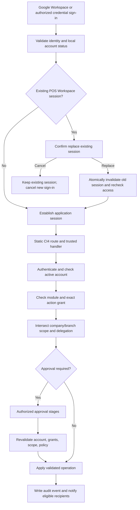
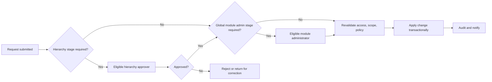

# POS Workspace V3 — Project Blueprint

## Current product objective (owner-provided; requirements may evolve during development)

The product goal is **POS Workspace V3 — POS Support Admin Console and Masterfile & Report System**: a centralized system for POS support administration, masterfile and report workflows, access management, and related operations. Deliver it incrementally, one module at a time; allow requirements and schema to evolve during development, and mark a module finalized only after its database structure, permissions, backend workflows, tests, and the owner's explicit confirmation are complete.

## How to read this document

- **Confirmed project fact** means current source/configuration demonstrates it.
- **Confirmed product requirement** means the project owner explicitly requires it. It does not mean the feature has been implemented.
- **Proposed design** means a candidate approach that still needs review/approval.
- **Unresolved decision** means requirements are not yet specific enough to implement safely.

Keep requirements and implementation evidence separate. `PROGRESS.md` records implementation status. `DATABASE.md` records only verifiable schema evidence.

## Confirmed project facts

- The repository is a CodeIgniter 4 starter application. `composer.json` requires PHP `^8.2` and `codeigniter4/framework` `^4.7`.
- The configured default database driver is MySQLi. The connection's database name is blank in the PHP config; no secret-bearing `.env` values were inspected.
- Current static routes are `/`, Login, Google Workspace authorization/callback, credential login, protected Dashboard, and logout. The current route file has no Module Registry, Module Settings, user-management, approval, or business-module routes. Historical business screens and handlers were removed in the 2026-10-23 cleanup; remaining service/test artifacts do not make those features reachable.
- The root route redirects unauthenticated visitors to Login and authenticated sessions to the protected Dashboard. The Dashboard is the post-login landing page; its account summary remains, while the birthday edit form has been removed.
- The login page presents Google Workspace first and the secondary Masterfile credential option beneath it. Its account-setup modal remains part of Login and reports account activation/role assignment only.
- `Login::google()` builds a Google OAuth authorization redirect using environment configuration and a session-bound state value. The registered callback exchanges the code over TLS-verified HTTPS, validates Google userinfo and its verified-email claim, matches the account against `usr_accounts` joined to `usr_roles`, and requires an active account and role.
- Successful Google authentication regenerates the session ID. The callback does not persist provider tokens. It saves a validated Google picture URL in `usr_accounts.avatar_url`, fills only blank first/last-name columns from optional Google profile claims, and the authenticated workspace displays the saved picture. Non-empty names are preserved.
- The login view offers Google Workspace as the primary option and a secondary Masterfile credential option. The live schema contains the distinct, unique nullable `usr_accounts.username` column.
- `/dashboard` is protected by `AuthFilter`, which rechecks account/role status from the database. Logout is a CSRF-protected POST. The current route file contains no Module Registry routes.
- The responsive workspace shell, shared Light Theme tokens, Login background/logo, account menu, and reusable navigation loading indicator remain in source. Dynamic module navigation is not implemented.
- The separate pending-account view and static starter welcome page were removed; the pending-account state is handled by the Login page's existing modal.
- `DATABASE.md` records five applied migrations and a 20-table live inventory checked on 2026-10-23. The migrations define module/action registry, RBAC grants, company/branch scope, reporting lines, approvals, audit, and outlet entities; the recorded live row counts show these configuration/business tables empty except for two modules and eight action rows. This inventory is dated and is not a claim about current live state.
- Git is not initialized in the project directory as inspected on 2026-10-22.

## Confirmed product requirements

These are owner-confirmed requirements for the product; implementation is not established unless separately confirmed in code and tracked in `PROGRESS.md`.

### Language and compatibility

- All POS Workspace V3 system UI text must always be in English.
- Use emerald green as the primary action/accent color, white and soft-gray light surfaces, rounded cards, subtle shadows, readable typography, accessible contrast/focus states, and responsive layouts. Dark navy may be used for navigation or appropriate sections. This 2026-10-25 owner direction supersedes the earlier blue-primary proposal below; existing UI source still uses blue/navy tokens and has not yet been restyled.
- Preserve the existing CodeIgniter 4 architecture and current working code.
- Develop incrementally: build a small coherent change, run the relevant checks, and collect feedback before expanding the implementation. Record what was verified and what remains untested; do not represent a planned feature as complete.
- Inspect the repository, current routes, reusable components, authentication, database configuration, tables, and migrations before each module. Summarize current behavior and intended files before broad changes. Reuse working components and conventions; do not rebuild or remove working features unnecessarily.
- For each module, define its purpose, workflow, schema, relationships, permissions, and dependencies before implementation. Follow the cycle **Build → Test → Revise → Retest → Finalize → Proceed**. Do not move to the next major module while the current module is under review; finalize only after explicit owner confirmation.
- Use CI4 migrations or version-controlled SQL for approved schema changes. Preserve existing data, inspect dependencies, and prepare a backup before destructive or high-risk operations unless the owner explicitly directs otherwise. Do not drop tables, reset the database, or delete user data without explicit approval. Avoid schema for unapproved features.

### Security and delivery

- Enforce authentication, account readiness, module/action permissions, and data scope server-side on every relevant request. Validate all input and prevent SQL injection, XSS, CSRF, and cross-user record access. Use transactions for related writes.
- Where separation of duties is required, prevent requesters from approving their own requests. Preserve historical attribution when transferring task or file ownership.
- For each module, record implemented behavior, files changed, database changes, manual test instructions, automated test results, and known limitations. Test normal and invalid input, authorization boundaries, approvals, migration safety, regression, and keyboard/touch accessibility where applicable. Never claim an unrun test passed.

### Login and activation

- Google Workspace is the primary sign-in method and must be displayed prominently at the top of the existing login card.
- Username and password is a secondary sign-in method for authorized Superadmins, external-company users, and approved testing accounts. Credential login uses a distinct, unique `usr_accounts.username`; email is not the credential username.
- Both sign-in methods must enforce the same server-side account activation and authorization rules. Superadmin GOD MODE requires an active account with Superadmin explicitly assigned.
- New Google users are automatically registered as `PENDING`, with no role, employee code, or module access, until administrator setup is complete. Google email remains verified and unique; do not invent placeholder names or assign roles automatically.
- When Google supplies them, save first and last name from the verified profile claims. Save the Google profile picture in `usr_accounts.avatar_url` and show it in the authenticated workspace. Birthday is an optional user-entered profile detail in Account Summary and must not be requested from Google sign-in.
- Pending users see the Account Setup Pending modal on the existing login screen.
- New users require administrator activation and assigned module access before normal use.

#### Single Active Session per Account (confirmed requirement; implementation not verified)

- A POS Workspace account may have at most one active application session. This does not sign the user out of Google Workspace or revoke an identity-provider session.
- If a second sign-in finds an active application session, show title **Account Already Signed In**, message **This account is already signed in on another device. Do you want to sign out the existing session and continue?**, and buttons **Cancel** and **Sign Out & Continue**.
- Cancel leaves the existing POS Workspace session valid and cancels the new sign-in. Sign Out & Continue must revalidate account status, role, permissions, scope, and other security checks, then invalidate the previous application session before establishing the new one.
- Enforce replacement on the server with secure unpredictable session identifiers/tokens and a concurrency-safe per-account operation. Handle expired sessions, disconnected devices, and concurrent requests. Never expose session identifiers in URLs or logs.
- Record successful and failed login, logout, and replacement events without recording credentials or tokens. Explain expiration and connectivity behavior in user-facing English.
- **Current implementation fact:** `app/Config/Session.php` uses CI4 `FileHandler`, a 7,200-second expiration, and session ID regeneration settings. These settings do not establish account-level single-session enforcement. No account-level replacement flow is implemented.
- **Proposed design:** use an account-level active-session registry/lease with atomic compare-and-replace semantics and a server-side session validation hook. Reconcile it with CI4 file sessions, expiration, garbage collection, and audit transaction behavior before proposing schema or authentication changes.

The login and registration requirements above are owner-confirmed. Keep implementation status separate from requirements: the owner reports the account migration was applied separately, and the supplied schema screenshot shows nullable username/name/role fields. Full post-migration keys and constraints remain to be rechecked as recorded in `DATABASE.md`.

### Roles and permissions

- Support Superadmin, regular users, and viewers.
- Assign permissions by module.
- Support company and branch access scope per user and per module.
- Validate account status and authentication, explicitly assigned role, module access, allowed actions, company/branch/outlet/device/personnel/record scope, and applicable approval requirements as distinct authorization checks. Hiding UI controls is not sufficient; enforce access on the server.
- Module-wide action availability must be intersected with each user's individual module/action grants. Superadmin configuration must not grant regular users access, and unsupported actions must remain unavailable rather than being enabled by registry metadata.
- Show Read as the `VIEW` permission code. Required Approval cannot weaken a mandatory global approval rule; when approval is required, the action must fail closed unless a valid workflow and active eligible approver exist.
- Organizational position alone does not grant module access. A Supervisor must not delegate permissions or data scope beyond their own authorized boundaries.
- Supervisors may configure only explicitly delegated local permissions for employees within their handled-user scope, and only for modules, actions, companies, branches, departments, and other scopes they are themselves authorized to manage. Local RBAC cannot exceed global permissions or weaken global policies. Pending permission changes do not become effective before required approval; existing effective access remains unchanged unless an authorized security action revokes it.

#### Module Action Registry and action-specific authorization (confirmed requirement)

- Each module defines stable action keys, display names, descriptions/categories, enabled state, and a mapping to a trusted implemented server-side handler or authorization policy. Examples include `inventory.transfer.request`, `inventory.transfer.approve`, `reports.send`, and `reports.schedule`; requesting and approving are separate permissions.
- A catalog entry is not executable functionality. Only developer-maintained routes and reviewed handlers can be mapped; registry metadata must never accept arbitrary PHP, SQL, scripts, or controller routes.
- Permission to request an operation never implies permission to approve it. Check active authentication/account, module assignment, exact action grant, company/branch scope, hierarchy/delegation where applicable, approval policy, and business validation on every protected operation.
- Keep module-wide action availability separate from per-role and per-user action grants. Disabled or unsupported actions fail closed, even when a UI control is visible.

### Global and local module policies

- Superadmin controls global module definitions and mandatory system rules, including module registration and identity, available actions and permitted workflows, mandatory approval requirements, whether a Module Administrator is required or permitted, which local policy settings are configurable, data-scope rules and delegation boundaries, and mandatory audit and recovery requirements.
- CRUD actions are not required for every module; some modules, such as dashboards and activity logs, may be view-only.
- Superadmin must be able to set Local Policies ON or OFF for each module and control which local policy categories are available. Turning Local Policies ON does not enable every category automatically.
- When Local Policies are ON, only authorized local administrators may configure globally permitted settings, with the required module permission and within their company, branch, outlet, device, personnel, and other applicable scope. Examples include local approval requirements, permitted data-scope assignments, report recipients and schedules, and handled-user configuration.
- Regular users may not modify Local Policies unless explicitly authorized. Viewers remain view-only.
- When Local Policies are OFF, local configuration is disabled and existing local settings remain effective but read-only under the approved design. Do not silently reset, delete, or replace those settings. Any transition or later change must preserve existing workflow behavior unless separately approved.

### Parent modules, submodules, and navigation

- Support parent modules and nested submodules. Each submodule must reference its parent module.
- Superadmin must be able to configure module names, short names/codes, parent relationships, icons, display order, active status, and permitted local policy categories through the database-driven Module Registry and Module Settings.
- Developers maintain actual route definitions and controller mappings in CodeIgniter 4's `app/Config/Routes.php`. Database records may not create executable routes or dynamically change controller mappings.
- Validate parent relationships and prevent circular module hierarchies.
- Generate the sidebar from active module records and their parent/submodule relationships stored in the database. Use the configured module name, short name/label, icon, and display order.
- Display only modules and submodules authorized for the logged-in user. Inactive modules must not appear in normal navigation.
- Derive parent visibility from accessible descendants: show a parent when the user has access to at least one active, accessible child; hide it when no such child exists. In nested hierarchies, propagate visibility upward when any accessible descendant exists.
- Parent visibility is for navigation only. It does not grant access to the parent route, sibling submodules, or actions, and it does not automatically grant child permissions.
- Independently enforce each submodule's route access, action permissions, account status, and data scope on the backend.
- Enforce route access, action permissions, account status, and data scope on the backend independently of sidebar visibility.
- Enforce module access and permissions on the backend for every protected route and action. Hiding a sidebar item is not authorization.
- Superadmin controls global module configuration, subject to authentication and audit safeguards.
- Module names listed as examples or candidates elsewhere in this blueprint are not thereby confirmed as the final module catalog.

### Dynamic Superadmin Module Registry

**Status: Additional owner-confirmed product requirement (2026-10-23).** The requirements below describe the intended registry and lifecycle behavior; existing implementation and gaps are recorded separately in `PROGRESS.md`.

- Superadmin must be able to view and search the complete registered module catalog, independent of which modules are assigned to regular users. The registry must support category, lifecycle status, and availability filters.
- Superadmin must be able to add modules, configure and edit their metadata, and activate, deactivate, or restore modules where appropriate. The registry must support configuration of navigation, permissions, user eligibility, company/branch scope, approval workflow, hierarchy, reports, and notifications.
- The Permissions / Module Access screen must expose module-wide action availability and Required Approval controls separately from per-user grants. Only actions backed by trusted, implemented handlers and developer-maintained routes may be configurable. Preserve Superadmin access and mandatory global approval rules; audit sensitive changes.
- Use a database-backed registry and shared navigation/configuration services so registered modules do not require duplicated sidebar/navigation implementations. Use data-driven registration/configuration where supported by the existing architecture.
- Registry metadata is descriptive configuration only. It must never execute arbitrary PHP, SQL, scripts, or dynamically supplied routes. A module may expose functional screens/actions only through trusted, implemented backend components and explicitly maintained CodeIgniter 4 routes.
- Show implementation status. If executable functionality is absent, do not imply that it exists and prevent misleading activation or success messages.
- Support `DRAFT`, `ACTIVE`, and `INACTIVE` lifecycle states. Validate module codes and reject duplicates.
- Before deletion, check dependencies and require appropriate authorization and explicit confirmation. Prefer deactivation when historical records, assignments, approvals, or audit references exist. Never implicitly delete business data, user assignments, approvals, or audit history because a module is deactivated or removed from navigation.
- Record sensitive registry and lifecycle actions in the audit log. Preserve mandatory approval rules and existing authentication, authorization, and other security controls.
- The meaning and data source of an “availability” filter, and the exact eligibility rules/dependency policy for permanent deletion, remain to be specified before implementation.

### Module Settings and responsive interface requirements

- The Module Settings dashboard must present the module registry with search and useful status/type/category filters, module description and status, company/branch filtering and approval indicators where configured, and actions to configure an entry or start a new draft. Provide an appropriate table layout on wider screens and readable cards or equivalent layouts on narrow screens.
- Present Module Registry and module-specific management as one Superadmin Module Settings destination with a module selector and section navigation. The registry catalog and module configuration should share the workspace; do not expose separate Module Registry and Module Management navigation entries.
- The module Profile screen should use a responsive, card-based layout with editable module information, a preview, static-implementation/route information, module policy summaries, and approval/approver summaries. Clearly distinguish saved read-only state from editable configuration; do not imply an icon upload, API endpoint, permission/policy write, or approver assignment exists unless supported by the application.
- Superadmin may import module icon images using click-to-select or drag-and-drop. Accept PNG, JPEG, and WebP only; enforce a 2 MB upload limit, verify and re-encode image content before storage, and use server-generated filenames. This requirement does not authorize schema changes or executable upload content.
- Keep per-module row actions in the three-dot menu, including module configuration, a quick lifecycle-status control, and eligible deletion. Status changes must continue through the existing authorized, CSRF-protected lifecycle action and retain its implementation checks and audit behavior.
- Provide a reusable workspace-wide loading indicator for same-origin page navigation and server-submitted forms that may wait on database work. Do not show it for cancelled submissions, same-page anchors, external/new-tab links, or downloads. Expose a shared show/hide API for asynchronous actions, and ensure those actions hide the indicator on both success and error.
- Module configuration is organized into Profile, Permissions/Module Access, Company/Branch Scope, Approval Workflow, Hierarchy, Reports, Notifications, and Activity/Audit sections. These sections must reflect the underlying saved state accurately; a display control must not imply a grant or configuration was saved when no supported write operation exists.
- Global Policies and Local Policies are separate Superadmin navigation destinations. Global policy authority and local policy settings remain distinct; local settings may expose only globally permitted categories and cannot weaken mandatory global rules.
- Creating a module begins in `DRAFT`. Activation must not expose a route unless the destination is backed by a developer-maintained static route and implemented handler. Route, controller, and component metadata remain descriptive and must not be interpreted as executable routing instructions.
- All system interfaces must adapt to mobile phones, tablets, laptops, standard desktop monitors, large monitors, event/presentation displays, and ultrawide screens. Use a consistent responsive layout; the sidebar may become a navigation drawer on smaller screens. Forms, buttons, search and filter controls, cards, tables, and modals must adapt to available space. Avoid overlapping, clipped, or inaccessible controls. Wide tables may scroll horizontally within their own container. Modals must fit the viewport and may use internal scrolling. Preserve readable typography, sensible spacing, keyboard navigation, visible focus indicators, and touch-friendly controls. Use available large-screen space effectively; do not simply shrink every element. Login, dashboards, Module Settings, User Management, Approval Queue, and reports follow the same standard.
- The initial appearance is Light Theme. Prepare reusable components and centralized CSS tokens for both Light and Dark themes, including backgrounds, text, borders, shadows, navigation, controls, focus, and status colors. Keep styling independent of theme selection and maintain readable contrast in both themes. Do not build a complex theme manager or add theme persistence until separately required. Use the current emerald-primary, white/soft-gray design direction with navy navigation where appropriate. All interface text remains in English.
- A future Theme Settings feature may offer Light Theme, Dark Theme, System Default, accent colors, and other approved appearance preferences. These are planned options, not current requirements to implement. When user-level preferences are added, store them independently per user; invalid or missing preferences must fall back to Light Theme. User preferences must not change another user's appearance, global branding, or protected administrative settings without authorization, and must not affect permissions, scopes, approvals, or business rules. Prefer a reusable theme service or centralized configuration. Do not add theme persistence schema merely to establish the initial Light Theme tokens.
- Test representative phone, tablet, laptop, desktop, and ultrawide viewport sizes. Record viewports and any cases that cannot be tested automatically; do not claim browser verification unless it was performed.
- These responsive and Module Settings requirements do not make the business module catalog final or approve any database policy, permission grant, scope assignment, approval rule, or approver assignment.

### Database table naming convention

- Use lowercase `snake_case` for all table and column names. Every table must have a meaningful prefix identifying its functional group; related tables must share that prefix. Follow the existing singular/plural convention consistently, and do not choose a prefix based only on record type when another module owns the table.
- Initial prefix registry: `usr_` for user identities, accounts, profiles, and account status; `rbac_` for roles, permissions, role assignments, and access policies; `mod_` for module registry, settings, and configuration; `org_` for departments, positions, reporting hierarchy, and organizational relationships; `out_` for Outlet List data; `tsk_` for task assignment/status/work tracking; `dpl_` for deployments/checklists; `doc_` for documents, file versions, and documentation metadata; `apr_` for approval requests/stages/decisions; `log_` for audit logs/activity history; and `ntf_` for notifications/email queue records. This registry may be extended when a new module is approved.
- Each table must have one documented owning module or shared platform component. Shared authentication, authorization, organization, approval, and audit structures must not be duplicated inside individual business modules. For example, Outlet List must reuse shared `usr_`, `rbac_`, `mod_`, `apr_`, and `log_` components where applicable.
- Check the live schema and dependencies before proposing table creation. Identify duplicates and naming conflicts, and propose renames separately from new tables. Any rename or prefix change requires a controlled, separately approved migration that updates dependent models, queries, foreign keys, tests, and documentation. Never rename or drop an existing table solely for naming consistency.
- Prefix examples and registry entries do not prove a table exists or authorize table creation or renaming. Preserve current table names until schema reconciliation and any required migration have been reviewed and approved. Document each verified or proposed table's purpose, prefix, relationships, and owner in `DATABASE.md`.

### Confirmed Superadmin GOD MODE requirement

**Status: Owner-confirmed product requirement (2026-10-22).** This describes required behavior; implementation is not established by this documentation.

- Superadmin has system-wide administrative access to all registered current and future modules.
- Superadmin can access all companies, all branches, and every available company/branch filter without individual company/branch scope assignments.
- Superadmin can access all module data and reports within the application's defined business rules and available data.
- When exercising authorized Superadmin privileges, Superadmin is exempt from ordinary user module assignments, company/branch restrictions, reporting hierarchy restrictions, and ordinary Module Admin approval workflows.
- Superadmin can manage users, roles, module access, module registry, approval settings, hierarchy, and system settings.
- Superadmin access does not bypass authentication, secure session handling, input validation, or other essential security controls.
- Sensitive Superadmin actions must be recorded in the activity/audit log.
- Regular users, viewers, supervisors, and Module Admins retain their own assigned permissions and scopes. Superadmin GOD MODE does not grant those users additional access.

### Company Management initial scope

**Status: Owner-confirmed product requirements (2026-10-23).** These requirements do not imply that the approval workflow or every Company Management operation is implemented.

- Use the existing active `COMPANY_BRANCH` module for Company Management. Do not create a duplicate module.
- Superadmin may access Company Management while the account and assigned Superadmin role are active. Other users require explicit per-user module access and the relevant action permission.
- For non-Superadmin users, company access is the intersection of the module-level company allowlist and the user's active company scope. Apply applicable branch scope and company/branch relationship checks independently on the backend.
- Company codes are trimmed for leading and trailing whitespace before validation and storage, and must remain unique.
- New companies start as `INACTIVE`. Do not hard-delete companies in the initial implementation.
- Company creation, edits, and status changes require approval. Company status changes use the `UPDATE` permission. Superadmin must not bypass approval required by a mandatory global policy.
- Approval-required company actions must remain unapplied until all required approvals are complete. If no valid approver is assigned, block the action and display exactly: “This action cannot proceed because no approver is assigned. Please contact your administrator.” Do not automatically approve or apply the change.
- Authorized Company Management users may view inactive company records for administration. Normal operational use of an inactive company and its dependent branches/resources must be blocked server-side.
- Deactivating a company preserves its company and branch records and does not rewrite branch statuses. A branch is operationally eligible only when both its own status and its parent company's status permit operation.
- Branch CRUD is outside the initial Company Management scope.

### Approvals and reporting relationships

- Support module-specific approval workflows and an Approval Queue.
- Support reporting hierarchy and user assignment relationships, including “reported-to” and “handled employees.”
- A Module Administrator assigned to a module does not need separate approval for their own authorized CRUD actions within that module. Other users follow the configured approval policy.
- If no Module Administrator is assigned, approval behavior follows the authorized Supervisor or configured hierarchy policy, subject to mandatory global rules.
- Local settings cannot disable a mandatory global approval requirement. If approval is required but no valid approval route exists, block the protected action until configuration is corrected.
- If an action requires approval, a valid approver must have an active account and explicit authorization for the relevant module, action, and applicable data scope. If no such approver is assigned, block the protected action. Do not bypass approval because an approver is inactive, unauthorized, unavailable, or outside the applicable scope.
- Never automatically approve, execute, or apply a protected change because an approver is unavailable or no valid approver is assigned. Do not introduce automatic approval exceptions or fallback approvers without a separate explicit decision.
- Apply this policy to create, update, delete, and any other action configured to require approval. When blocked because no valid approver is assigned, display exactly: “This action cannot proceed because no approver is assigned. Please contact your administrator.”
- Where configured, a Supervisor or hierarchy approver acts first, followed by the Module Administrator for final approval. Prevent self-approval when independent approval is required.
- Higher organizational position alone does not bypass a mandatory module approval rule. An authorized Superadmin may override local policies; record each override in the audit log.
- Notify authorized recipients about pending approval requests and decisions. Email addresses do not prove approval authority; validate approver eligibility on the server. Record decisions, decision timestamps, and rejection reasons. Local settings cannot bypass mandatory global approval requirements.

### Work tracking, activity, and employee handover

- The system is intended to support POS team task assignments and status changes, masterfile/documentation updates, deployment tracking, access requests, approvals/rejections, file uploads and revisions, ownership transfers, and employee handover.
- Record meaningful application activity with actor, action, affected record, timestamp, and relevant change details. Preserve historical attribution when ownership changes. Ordinary users must not alter or delete protected audit records.
- Activity records describe work performed in the application. Do not claim to monitor activity outside the application or make unsupported productivity-surveillance claims unless an approved integration actually implements that capability.
- Configure eligible approvers and notification recipients only for authorized administrators and within applicable global/local policy and data-scope limits.

### Superadmin safeguards and audit log

- Superadmin authority requires an active account with the Superadmin role explicitly assigned. Never infer it from email address, email domain, or login method.
- Superadmin authority does not bypass authentication or account-security checks. Sensitive overrides must record a reason where designated, and audit history must not be silently altered or bypassed.
- Record relevant successful, failed, and denied sensitive actions, including global module configuration and local policy changes; Superadmin overrides; account, role, permission, and data-scope changes; approval decisions and workflow changes; record creation, update, archive, restore, import, and revert operations; report configuration and scheduled email outcomes; and audit-log access and permitted exports.
- Audit details should include actor account and role, action and affected module or record, timestamp, previous and new values when applicable, relevant data scope, result, reason for designated sensitive actions, and related request or transaction reference when available.
- Never store passwords, authentication tokens, or other secrets in audit details. Normal administrative users must not silently modify or erase audit history.

### Module workflow governance

- Superadmin controls global workflow definitions. Selected users may create or configure processes only when explicitly granted delegated authority and within configured limits.
- Candidate modules for documentation and discussion include Outlet Management, Inventory Management, BIR Management, POS Management, User Access Management, Module Registry, Approval Queue, Reports and Scheduled Email, Organization and Hierarchy, and Audit and Recovery. This candidate list is not a final approved module catalog.

## Planned Superadmin areas

The requested Superadmin areas are product requirements. Individual screens may be implemented; implementation status is tracked in `PROGRESS.md` and must not be inferred from this list:

- Dashboard
- Profile
- Module Access
- Company/Branch Scope
- Hierarchy
- Activity Log
- Approval Queue
- Module Settings
- System Settings
- Reports
- Module Registry / Create New Module

## Planned modules and workflows

The first-implementation scope below was recorded on 2026-10-23 and is historical planning context. The later screen/controller removal means it is not a statement of current implementation. Reconcile the next implementation scope with the current roadmap and owner priorities before coding.

The exact business module catalog is not yet specified. The owner-confirmed requirements include module access, module-specific approvals, and module settings/registry. Earlier candidate areas for discussion include point-of-sale transactions, products/catalog, inventory, purchasing, customers, and reporting; these candidates are **proposed**, not an approved delivery scope.

**Current requested first implementation scope (2026-10-23; schema reconciliation and review are prerequisites):**

- Complete a database-backed Module Settings workflow with Profile, Module Access, Company/Branch Scope, Approval, Hierarchy, Reports, Notifications, and Activity Log sections. Load and save actual supported configuration; do not present static controls as persisted settings.
- Add Account Management for account search/filter/pagination, profile, role and module access, permissions, company/branch scope, position/department, primary `Reports To`, handled employees, activation/deactivation, effective-access preview, and relevant access history. A supervisor may see or configure only users and settings within delegated authority. Never display password hashes or secrets.
- Build **Outlet List** as the first functional test module. Reuse a verified existing outlet master table if present; otherwise propose a module-owned `out_` table after dependency review and approval. Support outlet code/name, company, branch/location where applicable, active/inactive status, search/filter/detail, and create/edit only where authorized. Do not register it as functional until its static route, handler, permissions, and saved configuration exist.
- Use the completed Outlet List flow to verify Superadmin, Supervisor, and Regular User boundaries, pending/approved/rejected changes, direct URL and request-parameter enforcement, audit history, regression, responsive viewports, theme-token readiness, and English-only system messages. Record actual tests and limitations.

These requirements do not authorize schema changes before the current schema reconciliation and naming conflicts are reviewed. Do not duplicate shared account, RBAC, approval, organization, or audit structures inside Outlet List.

At a high level, the requested user lifecycle is: Google Workspace sign-in → administrator activation and assignment of role, modules, company/branch scope, and reporting relationships → normal use only after required activation and access assignment. This describes a requirement, not the current implementation.

## Proposed designs

No detailed schema, module-specific permission matrix, approval state machine, or module plug-in architecture has been approved in the inspected documentation. The policy, approval, scope, and audit behaviors above are owner-confirmed requirements, but their implementation is not verified. Avoid turning candidate modules into a committed catalog. Present other designs for review before implementation, especially when they affect authentication, authorization, routes, or database schema.

## Master architecture and system flows (requirements and proposed design)

The diagram describes the intended guarded request path; only the current Login → Dashboard route flow is implemented. Module, scope, approval, and audit checks shown below are requirements, not evidence of working endpoints.

**Intended authorization order:** authenticate and verify active account; resolve the static route/action; verify module assignment and exact action permission; intersect module and user company/branch scope; apply hierarchy/delegation constraints; enforce approval policy; validate business data; apply atomically; record audit details and notify. Approval and mutation must be server-side. A failed check denies the operation regardless of visible UI controls.

## Module Registry and action lifecycle (confirmed requirements)

- Registry metadata includes stable module key, name, menu label/description, audience/workspace, developer-owned route/handler reference, status, registered actions, assigned module administrators, applicable approval policy, and display order/navigation configuration.
- Action metadata includes stable unique key, display name, category/description, enabled state, and a reviewed mapping to an implemented handler/policy. Example action keys are namespaced by module and verb, such as `inventory.transfer.request` and `inventory.transfer.approve`.
- A registered or enabled module is operational only after route, handler, permission, and required configuration validation. Metadata does not create routes or implement features. Unsupported actions stay disabled.
- Approval modes are **No Approval**, **Hierarchy Approval**, **Global Module Administrator Approval**, and **Combined Approval**; policies may be module/action-specific. Local policies cannot weaken a mandatory global policy.

## Hierarchy, delegation, and data scope (confirmed requirements)

- Hierarchy is configurable. An example chain is CEO → President → AVP → Group Manager → Manager → Assistant Manager → Senior Supervisor → Supervisor → Senior → Rank and File; it is illustrative, not a fixed list.
- Reporting relationships may record Reports To, handled/direct reports, position/level, active status, and effective dates when needed. Reporting hierarchy can determine reporting visibility and approval eligibility but does not grant module access.
- Module-level company/branch allowlists intersect with user-level module scopes. Enforce scope in lists, details, exports, reports, and writes. A user cannot delegate scope or permissions they do not possess. Access Preview must show effective access for each assigned module.
- Approval mode does not weaken scope checks. Supervisors manage only eligible direct reports within their own authority and scope.

## Approval workflow (confirmed requirement; implementation not verified)

Every required stage must finish before a protected change takes effect. Prevent self-approval where separation of duties applies; any configured Superadmin exception must be explicit and audited. Revalidate account status, exact permission, scope, and request state before applying. Track pending, approved, rejected, returned-for-correction, and escalated outcomes where applicable, including requester, approvers, timestamps, comments/reasons, and before/after values as appropriate. Approval Queue visibility is limited to assigned eligible approvers.

## Module-by-module screen specifications (planned)

All system text is English. The shared design standard is emerald primary actions with accessible contrast, white/soft-gray surfaces, rounded cards and subtle shadows, consistent typography/spacing, header/sidebar/profile/notifications/breadcrumbs where relevant, and responsive layouts with keyboard focus. Existing source currently uses blue/navy Light Theme tokens; emerald styling is a requirement and is not yet implemented.

| Screen | Purpose and key content | Actions and access | Required states/validation |
| --- | --- | --- | --- |
| Dashboard | Authorized workspace summary and navigation | Read only according to assigned modules | Loading, empty, access denied, data failure |
| Profile | Account details and allowed preferences | User edits only approved profile fields | Validation, save success/error, unavailable optional data |
| Module Access | Effective module and action grants | Administrators assign only within authority | Search/filter, empty, pending approval, denied action |
| Company & Branch Scope | Explain and configure effective scope | Authorized administrator; no scope escalation | Company/branch relationship validation, empty, effective-access preview |
| Hierarchy | Reporting relationships and handled employees | Delegated administrator within own scope | Active/inactive and effective dates; prevent invalid/circular reporting |
| Activity Log | Search authorized audit/activity records | Read/export only with explicit permission | Empty, loading, scoped results, export outcome |
| Approval Queue | Requests assigned to current approver | Review, approve, reject, return, escalate only if assigned | Pending/terminal states, reason validation, no self-approval where required |
| Module Settings / Registry | Catalog, lifecycle, profile, action and policy summaries | Superadmin or explicitly delegated configuration actions | Draft/active/inactive, unsupported functionality, validation and dependency checks |
| System Settings | Permitted global security/system policy | Explicit system-setting authority | Confirm sensitive changes, audit reason, failure and saved states |
| Reports | Authorized report generation and delivery | Exact report action permission and scope | Filters, empty/loading/error, generation/export/scheduling outcomes |
| User Management | Account status, role/access, scope, access preview | Authorized account administrator | Active/pending/inactive/unconfigured, validation, confirmation and audit |
| Help & Support | Guidance and support path if included | Read; support actions per policy | Empty/loading/error; no assumed integration |

Keep unrelated settings out of Reports. User Roles/Groups appear only if supported by the selected role-grant architecture; Help & Support remains optional. For each screen, accessible labels, visible focus, contrast, modal keyboard behavior, server-side authorization, and narrow-screen table/card behavior are acceptance criteria.

## Logical data model and migration plan (proposed mapping; not new schema fact)

The migration-defined tables currently documented in `DATABASE.md` provide partial building blocks for accounts/authentication identity, roles, modules/actions, role/user grants, company/branch scopes, reporting lines, approval requests/stages, active audit records, and outlets. The mapping does not prove that all required semantics or workflows are implemented. Notifications, action-handler registration metadata, effective access preview, and single-active-session tracking require a gap review. Do not create duplicate entities until the live schema and migration history are rechecked.

Before implementation, document each requirement-to-existing-table mapping, exact missing fields/constraints, ownership, retention, concurrency strategy, and migration/backfill/rollback plan. Prefer additive CI4 migrations with foreign keys and transactions. Obtain owner approval before any schema, authentication, session, route, or security-sensitive code change; do not execute migrations or alter live data as part of this documentation update. `DATABASE.md` remains the authority for schema verifiable from migrations/live metadata and explicitly notes that live MySQL was not rechecked in this documentation session.

## Acceptance test matrix (required before feature completion)

| Area | Required cases |
| --- | --- |
| UI/content | English-only system text; consistent design; keyboard/focus/contrast; phone, tablet, laptop, desktop, ultrawide; no clipped controls |
| Account readiness | Active, inactive, pending, unconfigured, unauthorized role; correct English outcomes and no normal access when blocked |
| RBAC | Direct URL/API attempts for unassigned modules/actions; request permission does not approve; disabled/unmapped actions denied server-side |
| Scope/delegation | Company/branch boundaries across list/detail/report/export/write; hierarchy limits; cannot delegate wider permission/scope |
| Registry | Stable unique keys; safe metadata; unsupported handlers cannot be activated; draft/active/inactive lifecycle and dependency checks |
| Approval | Each configured mode; missing/inactive/out-of-scope approver; self-approval; return/reject/escalation; revalidation before atomic apply; audit completeness |
| Sessions | Concurrent sign-ins; cancel and replacement; old session invalidation; expired/disconnected session; rejected replacement; Google global session remains untouched |
| Regression | Existing login, OAuth state/verification, account readiness, protected Dashboard, CSRF logout, and existing application behavior |

Run tests only when implementation work is authorized; record actual commands, results, and manual/browser checks in `PROGRESS.md`.

## Implementation roadmap and status

Status below distinguishes code/config evidence from requirements; details and exact next action live in `PROGRESS.md`.

1. **Foundation implemented:** CI4 application, Google Workspace and secondary credential sign-in paths, account-readiness checks, protected Dashboard, file-backed session configuration, and static routes. This does not include single-active-session enforcement.
2. **Database foundation applied (dated evidence):** five migrations for module/action, organization, RBAC/scope, approval, audit, and outlet tables; 2026-10-23 inventory is recorded in `DATABASE.md`. This does not mean operational screens/workflows exist.
3. **Partially implemented / currently unrouted:** module registry/access/approval/outlet database structures and retained service/test artifacts. Current `Routes.php` has no business-screen routes; no end-to-end business workflow is claimed.
4. **Planned:** reconcile schema and requirements; design/approve session replacement; define module/action catalog and handler mapping; implement a minimal vertical workflow with server-side auth/scope/approval/audit; add UI screens incrementally; test and obtain owner acceptance before finalizing each module.

## Decisions still open for this update

- Session registry representation, stale-session detection/lease policy, atomic locking approach, and exact behavior if audit recording fails during replacement.
- Initial module/action catalog and which trusted handlers exist in the first release.
- Hierarchy ownership, eligible approver/quorum rule, delegation/effective-date semantics, and escalation limits.
- User/group grant precedence, company/branch inheritance rules, and exact report/export scope semantics.
- Retention/access policy for login/session audit events and notification channels.

## Unresolved decisions

- Which Workspace domains are allowed? Is domain restriction required, and how are external collaborators handled?
- What is the administrator activation process, who may activate users, and can access assignments be changed after activation?
- What exact action sets and permission assignment model apply to each module and role, including the relationship between role-level grants and individual-user grants?
- How will module permissions and company/branch/department/outlet/device/personnel/record scope be represented and intersected in implementation?
- What is the final module catalog and initial release scope? Which modules are configurable, and what does “Create New Module” mean operationally?
- Define approval states and implementation details, including eligible approvers, escalation/delegation, and rejection/resubmission.
- Define “reported-to” and “handled employees,” hierarchy depth, multiple assignments, reassignment, and how these relationships affect visibility and approvals.
- What audit-log retention rules apply, and which administrative users may access or export audit history?
- What reports, exports, and data retention requirements are needed?
- Which OAuth callback/flow, state protection, identity checks, and production configuration will be adopted?
- How will the initial task, deployment, document, file revision, handover, notification, and work-activity workflows be defined and prioritized?
- The live `pos_workspace_v3` database and MariaDB version were verified in the dated inspection recorded in `DATABASE.md`; recheck them before any future database-dependent change.
